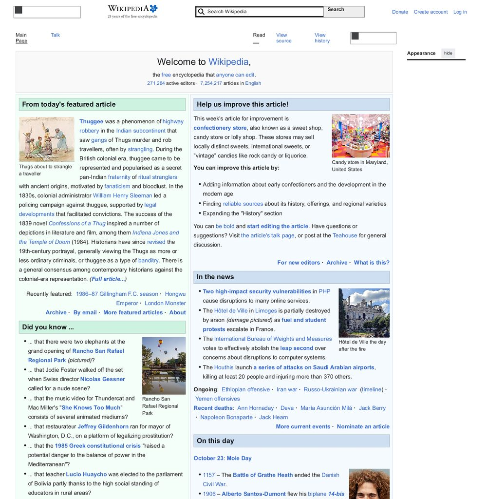

<div align="center">

# 🧅 OnionBit Explorer

**A web browser engine written from scratch in Rust — no imported engine, every browser-specific layer implemented here.**
*Un navigateur web écrit de zéro en Rust — aucun moteur importé, chaque couche métier est implémentée ici.*

[](https://github.com/laurentgeynet-ux/OnionBit-Explorer/actions/workflows/ci.yml)
[](https://github.com/laurentgeynet-ux/OnionBit-Explorer/actions/workflows/nightly-terrain.yml)
[](LICENSE-MIT)
[](https://www.rust-lang.org/)



*en.wikipedia.org — fetched, parsed, styled, laid out and painted
by this repository's engine code. No WebView, no imported engine.*

</div>

---

## What it is

OnionBit Explorer is a **complete browser stack built from zero** —
no `html5ever`, no Servo, no WebKit embed, no JS runtime borrowed.
Every browser-specific layer — networking policy, HTML, CSS, layout,
display list, the JS interpreter — is written in this tree.
Upstream infrastructure crates carry the commodity bricks
(TLS, HTTP/2 framing, raster primitives, text shaping, image/SVG
codecs) — the full, declared list is in `Cargo.toml` and ADR-0001:

| Layer | Crate | What's inside |
|---|---|---|
| **Networking** | `explorer-net` | URL/IDNA, DNS (+DoH), HTTP/1.1, HTTP/2 (via `h2`), TLS (rustls), cookies, cache, proxy — the only crate allowed to open sockets |
| **HTML** | `explorer-dom` + `explorer-html` | Arena DOM with generational ids, WHATWG-style tokenizer + tree builder |
| **CSS** | `explorer-css` | Tokenizer, selectors, cascade — `@layer`, custom properties, pseudo-elements, media queries |
| **Layout** | `explorer-layout` | Block/inline, **Flexbox, Grid**, floats, positioned elements, fragmentation, incremental relayout |
| **Rendering** | `explorer-render` | Display list → RGBA framebuffer → PNG — our own display model and paint, over `tiny-skia` (raster), `rustybuzz`/`ttf-parser` (text), `resvg` (SVG), `image` (codecs) |
| **JavaScript** | `explorer-jscore` | An interpreter written here — ES5+ core, classes, generators, promises/microtasks, modules, typed arrays, streams, IndexedDB, Cache API, `customElements`, observers, `crypto.subtle` (digests via `ring`), `matchMedia` (bounded)… tracked against **test262** |
| **Session** | `explorer-core` | Tabs, navigation, event loop, timers, bfcache, sub-resource scheduler, **iframes with per-frame JS realms** (incl. `srcdoc`, `sandbox`, dynamic insertion), History API, `window.open`/named targets, meta/`Refresh:` |
| **Interface** | `explorer-api` / `-daemon` / `-ffi` / `-cli` | Local **REST + SSE** control API, in-process FFI mode, dev CLI |
| **Client** | `app/` | **Flutter** desktop app — talks to the engine over the API, never touches core directly |

## Why it's interesting

- **Provably from scratch** — the architecture contract (ADR-0001)
  forbids importing an engine. Dependencies are infrastructure
  crates (tokio, rustls, tiny-skia, resvg, rustybuzz…) — all pure
  Rust except two exceptions declared and justified in the
  manifests (`ring` for TLS crypto, `stacker`/`psm` for stack
  growth; both carry asm, both documented).
- **Security plumbing as a feature** — `Sec-Fetch-*` metadata,
  real **CORS enforcement** (preflight `OPTIONS` + `ACAO`/`ACAC`),
  **CHIPS** `Partitioned` cookies, `SameSite`/`__Host-`/`__Secure-`,
  HSTS, mixed-content blocking, **Content-Security-Policy**
  enforcement (multi-policy intersection, meta CSP per spec —
  reporting endpoints not implemented), **SRI** `integrity=`,
  `Referrer-Policy`/`Referer`, `Origin` on non-safe methods,
  `nosniff`/CORP/`X-Frame-Options`, `Clear-Site-Data`,
  low-entropy Client Hints, `<iframe sandbox>`,
  per-page JS budgets
  (`EXPLORER_JS_MEM_MIB` / `EXPLORER_JS_OPS`) — content is hostile by default.
- **Honesty as a method** — compatibility is *measured*, never claimed,
  and every score carries its denominator: public suites
  (html5lib-tests, WPT reftest *slices*, test262 **extracts** —
  e.g. 1077 lexical-category files out of ~50 000, ≈ 2 %) and
  nightly real-site terrain runs (`scripts/site_smoke.ps1` — real
  `doc_h`, real `scroll_y`, hit-tested link clicks). Deviations and
  limits are written down in the open.
- **A two-team development model** — the repo is governed as
  **PIPELINE** (pure domain: parse → style → layout → raster) vs
  **NAVIGATEUR** (I/O, orchestration, all of JS), coordinated only
  through a public seam journal. Built to be driven by parallel
  work streams — human or agentic.

## Quick start

```powershell
cargo build -p explorer-daemon -p explorer-cli

# Headless flight — fetch, run JS, paint a real page:
explorer-cli shot https://en.wikipedia.org/wiki/Main_Page wiki.png 1366x900
explorer-cli dom https://lobste.rs
explorer-cli mem https://en.wikipedia.org   # per-reservoir memory attribution

# Or drive it like a product:
explorer-daemon            # REST + SSE on 127.0.0.1:9377
cd app && flutter run -d windows   # the Flutter desktop client
```

```powershell
pwsh -File scripts/verify_all.ps1   # full gate: fmt, clippy, tests, doc, flutter
pwsh -File scripts/site_smoke.ps1   # real-site terrain corpus
cargo fuzz run tokenizer            # fuzz targets: html, css, url
```

## Status

**Release 0.2.0 — active development, honest work in progress.**
Wikipedia, lobste.rs, MDN, rust-lang.org render and navigate;
the JS engine runs real-world scripts under explicit budgets.
Some walls are measured and documented, not hidden — e.g. JIT-class
proof-of-work challenges are marked *bounded by design* rather than "fixed".

> **⚠ Security notice — no sandbox.** The JS engine and renderer run
> *in the engine process*, with budgets (time, memory, depth) but
> **no OS-level sandboxing**. For hostile sites use the documented
> isolation mode: run `explorer-daemon` (separate process, REST+SSE)
> — never embed untrusted navigation in-process via FFI
> (ADR-0011 / ADR-0019). Do not browse sites you would not trust
> with code execution on your machine.

**Roadmap:** [`ROADMAP.md`](ROADMAP.md) → team files —
[`docs/roadmap-equipe-pipeline.md`](docs/roadmap-equipe-pipeline.md) (PIPELINE, steps `R-N`),
[`docs/roadmap-equipe-navigateur.md`](docs/roadmap-equipe-navigateur.md) (NAVIGATEUR, steps `NN` + `JS-CNN`).

## Documentation

| File | Role |
|---|---|
| [`AGENTS.md`](AGENTS.md) | The working contract — rules, conventions, gates |
| [`docs/architecture.md`](docs/architecture.md) | Layer and crate map |
| [`docs/architecture/decisions/`](docs/architecture/decisions/) | Numbered ADRs (ADR-0001…0025) |
| [`docs/interface-equipes.md`](docs/interface-equipes.md) | The inter-team seam journal — how parallel tracks synchronize |
| [`CHANGELOG.md`](CHANGELOG.md) | Keep-a-Changelog, every step numbered |

## Français 🇫🇷

**Navigateur web écrit from scratch** : moteur en Rust (réseau,
HTML, CSS, layout, rendu, JS) et interface **Flutter** desktop reliées
par une API de contrôle locale **REST + SSE** — l'app ne touche jamais
le moteur. Aucun moteur importé : chaque couche métier du pipeline
`fetch → parse → style → layout → render → paint` vit dans ce dépôt —
les briques d'infrastructure (TLS, framing HTTP/2, raster, shaping,
codecs image/SVG) sont des crates amont déclarées.
Compatibilité web moderne visée en **direction asymptotique** (ADR-0001),
mesurée par paliers sur corpus publics et terrain réel — les écarts et
limites sont documentés honnêtement, jamais maquillés.

## License

Dual-licensed under **MIT OR Apache-2.0** — [`LICENSE-MIT`](LICENSE-MIT)
and [`LICENSE-APACHE`](LICENSE-APACHE). You may use this code under
either license, at your option.
