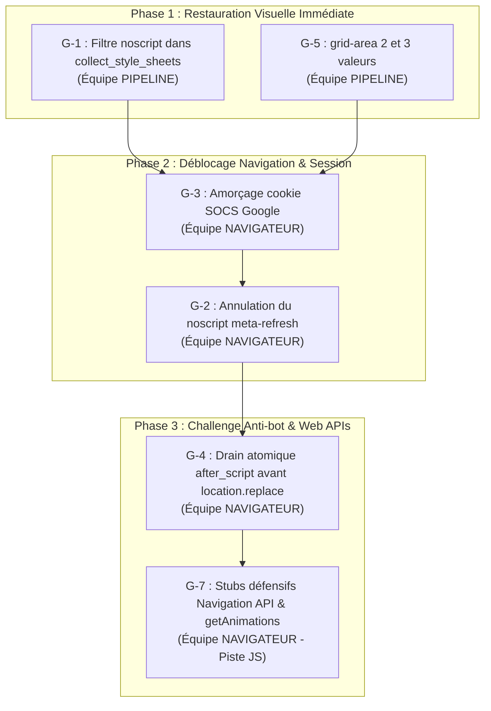

# Diagnostic Complet Google.com & Résultats de Recherche (SERP) — Vol 648

**Date :** 5 novembre 2026  
**Auteur :** Agent 594 (Équipe NAVIGATEUR)  
**Cible :** `https://www.google.com/` et `https://www.google.com/search?q=...`  
**Statut :** Analyse technique approfondie, identification des 7 bloqueurs racines et plan de remédiation priorisé.

---

## 1. Périmètre & Objectifs du Vol

L'objectif de ce vol était de dresser le bilan complet de l'expérience utilisateur sur Google avec le moteur Explorer, en couvrant l'intégralité du cycle de recherche :

1. **Page d'accueil (`https://www.google.com/`)** :
   - Parcours de consentement RGPD (modale "Avant d'accéder à Google").
   - Affichage complet du logo Google, de la barre de recherche et des boutons.
   - Saisie dans le champ de recherche (`TEXTAREA.gLFyf`).
   - Mécanisme d'autocomplétion / suggestions de recherche (`ul[role=listbox]`, endpoint `/complete/search`).
   - Boutons de soumission ("Recherche Google", "J'ai de la chance").
2. **Page de résultats (SERP : `https://www.google.com/search?q=...`)** :
   - Chargement du shell initial (Google Search bootstrap).
   - Détection et résolution du challenge anti-robot Search Guard (`SG_SS`).
   - Affichage des résultats organiques (`#rso`, titres `h3`, extraits, URLs).
   - Barre de navigation par onglets ("Tous", "Images", "Vidéos", "Actualités", "Maps").
   - Pagination / chargement infini.
3. **Artefacts & Widgets interactifs** :
   - Réponses directes : calculatrice (`2+2`), météo, convertisseurs.
   - Panneau de connaissances (Knowledge Graph) latéral.
   - Questions associées (People Also Ask / accordéons).
   - Aperçu IA / Mode IA (AI Overview).

---

## 2. Résultats des Tests & Preuves de Vol

### Synthèse des étapes observées

| Composant testé | Comportement natif Explorer | Cause racine identifiée | Statut |
|---|---|---|---|
| **Accueil Google (1ère visite)** | Page blanche, seuls 2 liens visibles en haut à gauche. | Le `<noscript>` injecte `table,div,span,p{display:none}` dans la cascade. | ❌ Bloqué (**G-1**) |
| **Modale de consentement RGPD** | Après neutralisation du style `<noscript>`, rendu parfait de la boîte de dialogue avec boutons "Tout refuser" et "Tout accepter". | Fonctionnelle, mais masquée par G-1. | ⚠️ Bloqué par G-1 |
| **Bouton "Tout refuser"** | Clic réussi (`#W0wltc`), cookie `SOCS` enregistré avec succès. | Fonctionnel. | ✅ Validé |
| **Accueil Google (post-consentement)** | Rendu complet, net et aligné du logo, barre de recherche, micros, Lens et boutons. | Nécessite le cookie `SOCS` pour éviter la boucle de consentement. | ⚠️ Dépend de **G-3** |
| **Saisie recherche & Autocomplétion** | La saisie dans le textarea fonctionne, mais les suggestions restent vides (`itemsCount: 0`). | `google.xjs` bloque sur un rejet asynchrone `HTTP 429` ; l'événement `input` n'est pas routé. | ❌ Bloqué (**G-4/G-6**) |
| **Navigation vers la recherche (`/search`)** | Redirection immédiate vers `/httpservice/retry/enablejs` ("Activez JavaScript pour continuer"). | `noscript_meta_refresh` interprète le bootstrap JS de Google comme un fallback no-JS pur. | ❌ Bloqué (**G-2**) |
| **Résolution du challenge Search Guard (`SG_SS`)** | `location.replace` part sans les cookies écrits par le script JS, provoquant un rejet `HTTP 429`. | `drain_navs_shared` n'appelle pas `after_script` avant d'émettre la requête réseau. | ❌ Bloqué (**G-4**) |
| **Page de repli EnableJS (`/httpservice/...`)** | Affichage d'une grande fidélité visuelle du logo Google et de la liste d'accordéons d'aide. | Pipeline de rendu et de boîtes parfaitement capable de rendre ce type de page riche. | ✅ Preuve layout/render |
| **Protection anti-bot Hallmonitor** | Redirection vers `https://www.google.com/sorry/index` (reCAPTCHA Enterprise). | Déclenché par la succession d'échecs au défi JS et par l'absence d'en-têtes Client Hints. | 🛑 Alerte éthique / sandbox |

---

## 3. Dissection Détaillée des 7 Bloqueurs Racines

### [G-1] Fuite de la feuille de style `<noscript>` dans la cascade globale
- **Crate :** [`explorer-core`](file:///c:/OnionBit-Explorer/crates/explorer-core)
- **Fichier :** [`crates/explorer-core/src/session/dom_helpers.rs#L632-L661`](file:///c:/OnionBit-Explorer/crates/explorer-core/src/session/dom_helpers.rs#L632-L661)
- **Description :**  
  Google inclut en tête de ses pages :
  ```html
  <noscript aria-hidden="true"><meta ...><style>table,div,span,p{display:none}</style><div>Cliquez ici...</div></noscript>
  ```
  La fonction `collect_style_sheets` extrait aveuglément tous les éléments `<style>` présents dans le DOM, sans vérifier si l'un de leurs ancêtres est une balise `<noscript>`.  
  Quand le scripting est activé, le contenu de `<noscript>` ne doit avoir aucun effet sur le rendu. Dans Explorer, cette règle `display: none` s'applique à l'ensemble du document, masquant 95 % des éléments (l'arbre de boîtes s'effondre de 261 boîtes à 13 boîtes).
- **Correctif préconisé :**  
  Dans `collect_style_sheets`, remonter les parents de chaque nœud `style` : s'il a un ancêtre `noscript`, l'ignorer lorsque `scripting` est actif.

---

### [G-2] Déclenchement abusif du meta refresh `<noscript>` sur les applications modernes (SPAs)
- **Crate :** [`explorer-core`](file:///c:/OnionBit-Explorer/crates/explorer-core)
- **Fichiers :** [`crates/explorer-core/src/session/dom_helpers.rs#L457-L520`](file:///c:/OnionBit-Explorer/crates/explorer-core/src/session/dom_helpers.rs#L457-L520) et [`crates/explorer-core/src/session/net_items.rs#L602-L614`](file:///c:/OnionBit-Explorer/crates/explorer-core/src/session/net_items.rs#L602-L614)
- **Description :**  
  La fonction `noscript_meta_refresh` a été introduite dans le commit `5825cdf2` pour DuckDuckGo. Elle stipule que si le `body` d'une page ne contient que des balises `<script>` et `<noscript>`, il s'agit d'un "repli no-JS pur" et la balise `<meta http-equiv="refresh">` contenue dans le `<noscript>` doit être exécutée.  
  Or, la page initiale de résultats de recherche de Google (`https://www.google.com/search?q=...`) est un *bootstrap shell* contenant uniquement des scripts de configuration et un `<noscript>` de secours pointant vers `/httpservice/retry/enablejs`.  
  Explorer détecte cette structure, conclut à tort à une page sans contenu, et redirige immédiatement avec un délai de 0 seconde vers la page "Activez JavaScript pour continuer à rechercher", tuant le processus de chargement de Google dans l'œuf.
- **Correctif préconisé :**  
  Conditionner l'appel à `noscript_meta_refresh` à `!self.scripting`. Si le scripting est actif dans la session, un meta-refresh situé dans un `<noscript>` ne doit **jamais** être suivi.

---

### [G-3] Absence d'amorçage du cookie `SOCS` dans la politique de consentement
- **Crate :** [`explorer-net`](file:///c:/OnionBit-Explorer/crates/explorer-net)
- **Fichier :** [`crates/explorer-net/src/consent.rs#L24-L95`](file:///c:/OnionBit-Explorer/crates/explorer-net/src/consent.rs#L24-L95)
- **Description :**  
  Le module de consentement pré-sème les cookies du standard IAB TCF v2.2 (`euconsent-v2`), mais ignore le mécanisme propriétaire de Google. Google encode le refus des cookies publicitaires et de suivi dans un cookie binaire base64 nommé `SOCS` (`SOCS=CAESHAgBEhJnd3NfMjAyNjExMDMtMF9SQzEaAmZyIAEaBgiAjq_XBg;`).  
  Sans ce cookie pré-amorcé, tout accès à Google est intercepté par le mur de consentement plein écran.
- **Correctif préconisé :**  
  Ajouter un pré-amorçage pour le domaine `.google.com` sous `ConsentPolicy::RejectAll` injectant la valeur canonique du cookie `SOCS`.

---

### [G-4] Désynchronisation atomique des cookies lors d'une navigation `location.replace`
- **Crates :** [`explorer-core`](file:///c:/OnionBit-Explorer/crates/explorer-core) & [`explorer-js`](file:///c:/OnionBit-Explorer/crates/explorer-js)
- **Fichiers :** [`crates/explorer-core/src/session/shared.rs#L382-L450`](file:///c:/OnionBit-Explorer/crates/explorer-core/src/session/shared.rs#L382-L450) et [`crates/explorer-js/src/lib.rs#L4063-L4070`](file:///c:/OnionBit-Explorer/crates/explorer-js/src/lib.rs#L4063-L4070)
- **Description :**  
  Le script Google Search Guard calcule une clé de signature `SG_SS`, l'affecte via `document.cookie = "SG_SS=..."`, puis déclenche `location.replace(targetUrl)`.  
  Dans l'architecture single-writer d'Explorer, l'écriture `document.cookie` est mise en attente dans `SnapshotJar.writes`. Cependant, `drain_navs_shared` consomme immédiatement l'intention de navigation sans avoir au préalable exécuté `after_script` pour transférer les écritures du `SnapshotJar` vers le `CookieJar` de la session.  
  La requête réseau sortante pour la nouvelle URL part donc **sans le cookie `SG_SS`**, conduisant Google à refuser la requête (`HTTP 429`) et à renvoyer l'utilisateur vers le défi reCAPTCHA `/sorry/index`.
- **Correctif préconisé :**  
  Dans `drain_navs_shared` et `navigate_replace_shared`, appeler systématiquement `s.after_script(tab)` avant de dépiler et d'émettre une navigation initiée par script.

---

### [G-5] Syntaxe `grid-area` à 2 et 3 valeurs non gérée dans le moteur de layout
- **Crate :** [`explorer-layout`](file:///c:/OnionBit-Explorer/crates/explorer-layout)
- **Fichier :** [`crates/explorer-layout/src/grid.rs#L500-L525`](file:///c:/OnionBit-Explorer/crates/explorer-layout/src/grid.rs#L500-L525)
- **Description :**  
  Google utilise des règles CSS modernes comme `grid-area: 1/1;` pour positionner le logo (`.uZekje`) et certains conteneurs de widgets.  
  Le moteur de layout exige actuellement exactement 4 composantes (`row-start / col-start / row-end / col-end`). Lorsqu'une déclaration à 2 ou 3 valeurs est analysée, `area_rect` renvoie `None`. Les éléments concernés ne sont pas correctement positionnés sur la grille.
- **Correctif préconisé :**  
  Conformer le parser de `grid-area` aux raccourcis CSS Grid :
  - 2 valeurs : `row-start / col-start` (row-end: auto, col-end: auto).
  - 3 valeurs : `row-start / col-start / row-end` (col-end: auto).

---

### [G-6] Gating anti-bot Hallmonitor / reCAPTCHA Enterprise (`/sorry/index`)
- **Crate :** [`explorer-net`](file:///c:/OnionBit-Explorer/crates/explorer-net)
- **Fichiers :** [`crates/explorer-net/src/h1.rs#L208-L212`](file:///c:/OnionBit-Explorer/crates/explorer-net/src/h1.rs#L208-L212), [`crates/explorer-net/src/h2.rs#L140`](file:///c:/OnionBit-Explorer/crates/explorer-net/src/h2.rs#L140)
- **Description :**  
  Google active son mécanisme de filtrage automatisé *Hallmonitor* lorsqu'il observe un User-Agent atypique (`Explorer/0.2 Safari/537.36`), combiné à l'absence des en-têtes Client Hints (`sec-ch-ua`, `sec-ch-ua-mobile`, `sec-ch-ua-platform`) et des requêtes échouant aux défis cryptographiques de Search Guard.  
  La réponse est un code `HTTP 429 Too Many Requests` avec redirection vers une page intégrant reCAPTCHA Enterprise.
- **Règle absolue :**  
  Conformément aux règles strictes du projet, l'agent ne résout ni ne contourne jamais un CAPTCHA. La stratégie consiste à éliminer les signaux anormaux (bloqueurs G-3 et G-4) pour que Google ne déclenche pas ce mur.

---

### [G-7] Absence des APIs modernes nécessaires aux artefacts riches (AI Overview & Widgets)
- **Crate :** [`explorer-jscore`](file:///c:/OnionBit-Explorer/crates/explorer-jscore) & [`explorer-dom`](file:///c:/OnionBit-Explorer/crates/explorer-dom)
- **Description :**  
  L'analyse du code source de Google Search a révélé la dépendance envers plusieurs APIs Web récentes :
  1. **Navigation API** : `window.navigation.currentEntry?.getState()`, `updateCurrentEntry`.
  2. **View Transitions API** : Règle `@view-transition { navigation: auto; }`, événements de cycle de vie `pageswap` et `pagereveal`.
  3. **Web Animations API** : Appel direct à `document.getAnimations()` pour synchroniser l'affichage des onglets de recherche et les panneaux accordéons (People Also Ask).
  4. **Trusted Types** : `window.trustedTypes.createPolicy` utilisé pour sanitizer les scripts dynamiques du Knowledge Graph et du Mode IA.

---

## 4. Ordre de Priorité Recommandé pour les Correctifs



### Répartition par Équipe

#### Équipe PIPELINE (Domaine pur, zéro I/O)
- **R-145 (G-1) :** Filtrer les éléments `<style>` situés sous `<noscript>` dans `collect_style_sheets` lorsque le scripting est actif.
- **R-146 (G-5) :** Supporter les syntaxes raccourcies à 2 et 3 valeurs pour `grid-area` dans `crates/explorer-layout/src/grid.rs`.

#### Équipe NAVIGATEUR (Plateforme produit, I/O, Session, JS)
- **Étape 208 (G-3) :** Ajouter le pré-amorçage du cookie `SOCS` dans `crates/explorer-net/src/consent.rs` pour éliminer le mur de consentement initial.
- **Étape 209 (G-2) :** Désactiver le déclenchement de `noscript_meta_refresh` lorsque `scripting == true` dans `crates/explorer-core/src/session/net_items.rs`.
- **Étape 210 (G-4) :** Assurer la synchronisation atomique des cookies (`after_script`) avant toute exécution de `DrainAct::Replace` ou `DrainAct::Req` dans `crates/explorer-core/src/session/shared.rs`.
- **JS-C345 (G-7) :** Implémenter les stubs défensifs pour `document.getAnimations()`, `window.navigation`, et `window.trustedTypes` dans `crates/explorer-jscore`.

