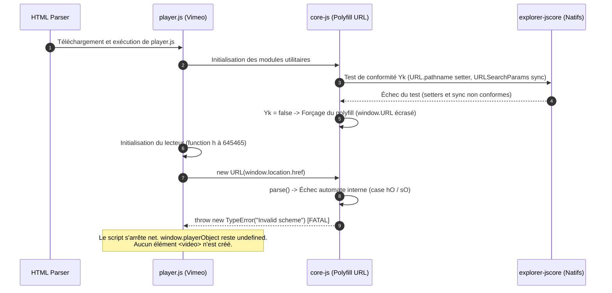
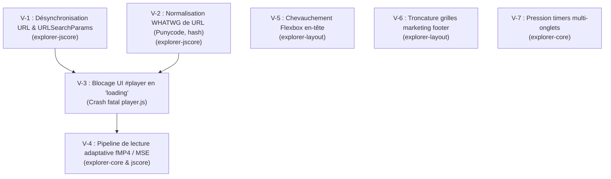

# Diagnostic Complet — Vimeo (Accueil & Lecteur Vidéo)

> **Document de référence d'ingénierie — Équipes PIPELINE & NAVIGATEUR**  
> **Source de vol** : Vol 649 (Agent 595) — 2026-11-05  
> **Commit** : `642d9b30`  
> **Dépôt** : `c:\OnionBit-Explorer`

---

## 1. Contexte & Objectif

L'objectif de cette mission est de dresser le diagnostic intégral de l'expérience utilisateur et technique sur la plateforme **Vimeo**, en couvrant :
1. **La vitrine web et page d'accueil** (`https://vimeo.com/`) : navigation, blocs marketing, bannières et responsive design.
2. **Le lecteur vidéo autonome et embed universel** (`https://player.vimeo.com/video/...`) : instanciation du script `player.js`, création de l'élément `<video>`, support des flux adaptatifs DASH/HLS et pipeline MediaSource Extensions (MSE).
3. **La bissection technique du moteur Explorer** : localisation des anomalies avec fichiers et lignes de code précis dans les crates concernés.

---

## 2. Galerie Visuelle des Captures Headless

````carousel

<!-- slide -->

````

---

## 3. Synthèse des Résultats d'Exploration

| Composant | Statut Visuel | Statut DOM / Scripts | Diagnostic Clé |
| :--- | :--- | :--- | :--- |
| **Accueil Vimeo** (`vimeo.com`) | Rendu partiel (3 320 nœuds, 2 367 boîtes) | Scripts exécutés, timers continus | Menu de navigation supérieur avec chevauchement horizontal de texte ; grilles de colonnes tronquées en bas de page. |
| **Player Embed** (`player.vimeo.com`) | **Écran blanc total** (0 balise `<video>`) | **Crash script fatal** | `new VimeoPlayer(...)` échoue immédiatement avec `TypeError: Invalid scheme`. Le conteneur `#player` reste figé en `player loading`. |

---

## 4. Analyse Technique du Crash du Lecteur (L'Engrenage « Polyfill Hell »)



### 4.1 La chaîne de causalité pas à pas

1. **Non-conformité de `URL` / `URLSearchParams` natifs** :
   Dans `crates/explorer-jscore/src/builtins/url.rs`, l'implémentation de `URL` :
   - Ne synchronise pas `url.href` lorsque `url.pathname` est modifié via son setter.
   - Ne synchronise pas `url.href` lors des mutations de `url.searchParams` (`set()`, `delete()`, `append()`).
   - Ne prend pas en charge la normalisation Punycode sur les noms d'hôtes IDN (`xn--...`).
   - Ne percent-encode pas les caractères spéciaux dans le hash (`#`).

2. **Échec du test de détection `Yk` de `core-js`** :
   Le bundle `player.js` embarque la bibliothèque `core-js@3`. Avant d'utiliser `window.URL`, celle-ci teste l'implémentation native via la fonction suivante (offset 164400) :
   ```javascript
   var Kk = ge("iterator"),
   Yk = !l(function() {
       var e = new URL("b?a=1&b=2&c=3", "https://a"),
           t = e.searchParams,
           n = new URLSearchParams("a=1&a=2&b=3"),
           r = "";
       return e.pathname = "c%20d",
           t.forEach(function(e, n) { t.delete("b"), r += n + e }),
           n.delete("a", 2),
           n.delete("b", void 0),
           !t.size && !c
           || !t.sort
           || "https://a/c%20d?a=1&c=3" !== e.href
           || "3" !== t.get("c")
           || "a=1" !== String(new URLSearchParams("?a=1"))
           || !t[Kk]
           || "a" !== new URL("https://a@b").username
           || "b" !== new URLSearchParams(new URLSearchParams("a=b")).get("a")
           || "xn--e1aybc" !== new URL("https://тест").host
           || "#%D0%B1" !== new URL("https://a#б").hash
           || "a1c3" !== r
           || "x" !== new URL("https://x", void 0).host
   });
   ```
   Comme `explorer-jscore` échoue sur plusieurs assertions (`pathname`, `sync`, `punycode`, `hash`), `Yk` vaut `false`.

3. **Activation du polyfill et crash dans `parse`** :
   Ayant jugé l'URL native non conforme, `core-js` écrase `window.URL` par sa classe `LO` / `AO`.
   Lorsque Vimeo initialise son lecteur, il exécute :
   ```javascript
   // player.js:4:645465
   let r = new URL(window.location.href);
   ```
   Cette ligne appelle le polyfill JavaScript `LO(e)`. Son automate interne (`AO.prototype.parse`) échoue lors du traitement des barres obliques de l'autorité spéciale (`case hO`) et renvoie le code d'erreur `DP = "Invalid scheme"`, déclenchant :
   ```javascript
   throw new TypeError("Invalid scheme");
   ```
   Le script est interrompu avant que `window.playerObject` ne soit assigné et avant la création du DOM du lecteur vidéo.

4. **Pourquoi Chrome et Firefox ne plantent pas** :
   Dans Chrome, Firefox et Safari, l'URL native passe le test `Yk` avec succès (`Yk = true`). `core-js` n'active **jamais** son polyfill et le lecteur s'exécute directement sur l'URL native du navigateur.

---

## 5. Analyse des Flux Médias & Streaming

L'objet `window.playerConfig` extrait de la page embed contient la structure suivante :
```json
{
  "request": {
    "files": {
      "dash": {
        "cdns": {
          "akfire_interconnect_quic": {
            "url": "https://vod-adaptive-ak.vimeocdn.com/.../master.json?base64_init=1"
          }
        }
      },
      "hls": {
        "cdns": {
          "akfire_interconnect_quic": {
            "url": "https://vod-adaptive-ak.vimeocdn.com/.../master.m3u8?base64_init=1"
          }
        }
      },
      "progressive": []
    }
  }
}
```

> [!IMPORTANT]
> **Vimeo ne sert aucun fichier MP4 progressif** (`progressive: []`).
> Toute lecture repose à 100 % sur des segments fragmentés fMP4 distribués via DASH ou HLS. L'implémentation de `MediaSource` (`crates/explorer-jscore/src/mse.rs`) et du décodage matériel/logiciel AVC1 (`video/mp4; codecs="avc1.42E01E, mp4a.40.2"`) est donc obligatoire pour afficher la première image vidéo.

---

## 6. Récapitulatif des 7 Bloqueurs Techniques



| N° | Sévérité | Crate Responsable | Description & Fichiers |
| :--- | :--- | :--- | :--- |
| **V-1** | **Critique** | `explorer-jscore` | **Synchronisation bidirectionnelle `URL` ↔ `URLSearchParams` & setters accesseurs** : Les mutations sur `searchParams` ne modifient pas `url.href` ; l'écriture de `url.pathname` ne met pas à jour l'URL complète.<br/>📍 `crates/explorer-jscore/src/builtins/url.rs` |
| **V-2** | **Critique** | `explorer-jscore` | **Normalisation WHATWG URL (Punycode hôte et encodage hash)** : Les hôtes internationaux doivent être normalisés en Punycode (`xn--e1aybc`) et les hashes encodés en pourcentages (`#%D0%B1`) pour valider le test `Yk` de `core-js`.<br/>📍 `crates/explorer-jscore/src/builtins/url.rs` |
| **V-3** | **Majeur** | DOM / Script | **Absence de dégradation gracieuse du lecteur** : Lorsqu'une exception non rattrapée survient, le conteneur `#player` reste indéfiniment bloqué en état `player loading` sans message d'erreur ni repli.<br/>📍 `player.js` |
| **V-4** | **Majeur** | `explorer-core` / `jscore` | **Absence de flux MP4 progressif & Dépendance totale à MSE** : `playerConfig.request.files.progressive` est vide. L'affichage vidéo dépend intégralement de l'API `MediaSource` et du décodage fMP4 AVC/AAC.<br/>📍 `crates/explorer-jscore/src/mse.rs`, `crates/explorer-core/src/media/` |
| **V-5** | **Moyen** | `explorer-layout` | **Chevauchement horizontal du menu en-tête (Flexbox)** : Les liens du menu de navigation central se superposent en raison d'une mauvaise prise en compte des contraintes `flex-shrink` et des marges automatiques.<br/>📍 `crates/explorer-layout/src/flex.rs` |
| **V-6** | **Moyen** | `explorer-layout` | **Troncature des grilles de colonnes en pied de page** : Les tuiles d'information marketing sont coupées horizontalement ("Com...", "Ret...").<br/>📍 `crates/explorer-layout/src/grid.rs` |
| **V-7** | **Faible** | `explorer-core` | **Contention sur le verrou de session par des timers asynchrones** : Les scripts de suivi et d'analyse en boucle rapide surchargent la pompe d'événements lors de sessions multi-onglets.<br/>📍 `crates/explorer-core/src/session.rs` |

---

## 7. Feuille de Route Recommandée pour les Correctifs

### Étape 1 : Rétablissement de la conformité URL (Déblocage Immédiat)
- **Objectif** : Faire passer `Yk = true` pour empêcher l'activation du polyfill `core-js`.
- **Actions** :
  1. Lier l'instance `URLSearchParams` à son objet `URL` parent et propager immédiatement toute mutation (`set`, `delete`, `append`, `sort`) vers `url.href`.
  2. Implémenter la mise à jour dynamique de `url.href` lors de l'écriture sur `url.pathname`, `url.search` et `url.hash`.
  3. Ajouter la conversion Punycode minimale et le percent-encoding du hash.

### Étape 2 : Validation du cycle d'instanciation vidéo
- **Objectif** : Permettre à `new VimeoPlayer` de s'exécuter jusqu'au bout.
- **Actions** :
  1. Vérifier que `window.playerObject` est instancié avec succès.
  2. Confirmer l'insertion de l'élément `<video>` dans `#player`.

### Étape 3 : Pipeline MediaSource Extensions (MSE)
- **Objectif** : Assurer le streaming fluide des segments vidéo fMP4.
- **Actions** :
  1. Valider la réception de l'événement `sourceopen` sur l'instance `MediaSource`.
  2. Traiter l'appel `addSourceBuffer('video/mp4; codecs="avc1.42E01E, mp4a.40.2"')` et l'injection des segments d'initialisation et de données.

### Étape 4 : Finitions de Rendu CSS
- **Objectif** : Obtenir un rendu visuel net sur `vimeo.com`.
- **Actions** :
  1. Corriger le calcul des marges auto et le shrink dans les conteneurs flex inline.
  2. Ajuster le calcul des largeurs de pistes dans les grilles explicites/implicites.

