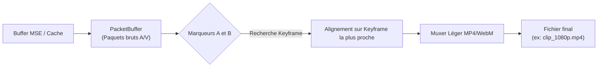

# Plan d'Implémentation 01 — Extracteur Média & Découpeur de Clip (Zéro Ré-encodage)

## 1. Contexte & Problématique

Sur le web actuel, lorsqu'un internaute souhaite conserver un court extrait de vidéo (un clip de 15 secondes sur YouTube ou Twitch, une capture photo en haute définition sans compression d'écran, ou une bande sonore de podcast), il est contraint de :
- Utiliser des sites web tiers de téléchargement douteux, saturés de publicités et de malwares.
- Recourir à des extensions de navigateur lourdes et souvent bannies des stores.
- Utiliser des outils d'enregistrement d'écran (OBS, Snipping Tool) qui dégradent la qualité et capturent les éléments d'interface.

### L'Avantage Unique d'OnionBit-Explorer
Notre moteur [`onionmedia`](file:///C:/Onion-explorer-media/crates/onionmedia/src/player.rs) et ses démuxeurs [`onioncodec`](file:///C:/Onion-explorer-media/crates/onioncodec-demux-mp4/src/lib.rs) possèdent **déjà** :
1. Les paquets audio et vidéo originaux fMP4/WebM en mémoire dans le [`PacketBuffer`](file:///C:/Onion-explorer-media/crates/onionmedia-pipe/src/packet_buffer.rs).
2. Les trames vidéo décompressées brutes en résolution native (`SpecFrame`, pixels YUV/RGBA réels).

---

## 2. Spécification Fonctionnelle

Le navigateur propose un menu contextuel et des boutons sur la barre de contrôle vidéo :

```
┌───────────────────────────────────────────────────────────────┐
│                      Lecteur Vidéo Web                        │
│                                                               │
│                     [ Image Vidéo HD ]                        │
│                                                               │
├───────────────────────────────────────────────────────────────┤
│  [►] 01:15 ━━━━[A]━━━━━━━━━[B]━━━━━━━━━━━━━━━━━━━━━━━ 10:42  │
│                                                               │
│  [ 📸 Capture HD ]  [ ✂️ Sauver Clip ]  [ 🎵 Extraire Audio ]  │
└───────────────────────────────────────────────────────────────┘
```

1. **Capture d'image bit-exact (PNG / JPEG)** :
   - Extrait la frame courante affichée à sa résolution native exacte (ex. 1920×1080 ou 3840×2160), indépendamment de la taille de la fenêtre ou du zoom d'affichage.
   - Zéro interpolation, zéro bandes noires, aucune interface visible.
   - Enregistrement direct dans le dossier Téléchargements ou copie dans le presse-papier.

2. **Création de Clip instantanée (Zéro ré-encodage)** :
   - L'utilisateur positionne un marqueur d'entrée `[A]` et un marqueur de sortie `[B]`.
   - Clic sur "Sauvegarder Clip" $\rightarrow$ écriture du fichier MP4 en **moins de 200 millisecondes**.
   - Pas de ré-encodage lourd : les paquets H.264/VP9/AV1 et AAC/Opus compris entre les repères sont simplement remuxés dans un conteneur MP4/WebM propre avec recalage des timestamps.

3. **Extraction de la piste audio** :
   - Téléchargement direct du flux audio brut en fichier natif (`.m4a` pour l'AAC, `.opus` pour l'Opus) sans décompression ni perte de qualité.

---

## 3. Architecture Technique

### 3.1. Capture d'écran Bit-Exact (Côté Rust & FFI)

Le moteur dispose de la texture GPU (Direct3D 11) ou du buffer CPU de la trame en cours :

1. **Symbole FFI dans `onionmedia-ffi`** :
   ```rust
   #[unsafe(no_mangle)]
   pub extern "C" fn onionmedia_capture_frame(
       player: *mut c_void,
       out_path_utf8: *const c_char,
       format: u32, // 0 = PNG, 1 = JPEG
   ) -> i32
   ```
2. **Implémentation dans `onionmedia`** :
   - Snapshot synchrone du dernier `SpecFrame` dans le thread de rendu.
   - Encodage direct via un encodeur PNG/JPEG ultra-léger sans dépendance lourde (`image` crate ou mini-PNG Rust).
   - Écriture sur disque ou restitution d'un buffer mémoire pour le presse-papier Windows (`OpenClipboard` / Flutter `Clipboard`).

### 3.2. Remuxing de Clip sans Ré-encodage



1. **Alignement Keyframe (I-Frame)** :
   - La coupure commence à la trame clé précédant immédiatement le point `[A]` pour garantir la lisibilité instantanée du fichier sans glitch visuel.
2. **Ré-écriture des timestamps** :
   - Soustraction de `PTS_A` à chaque paquet pour que le clip commence à `PTS = 00:00:00`.
3. **Muxage direct** :
   - Écriture des en-têtes fMP4 `ftyp`, `moov`, puis des boîtes `moof` + `mdat` assemblées.
   - Vitesse : égale à la vitesse d'écriture disque (~500 Mo/s sur SSD NVMe).

---

## 4. Feuille de Route d'Implémentation

### Phase 1 : Snapshot HD Bit-Exact
- [ ] Ajouter la méthode `capture_current_frame()` dans `onionmedia::Player`.
- [ ] Exposer `onionmedia_capture_frame` dans `onionmedia-ffi`.
- [ ] Ajouter le bouton icône 📸 dans le contrôleur de lecture Dart (`media_controls.dart`).
- [ ] Connecter au presse-papier Windows et au sélecteur de fichier de sauvegarde.

### Phase 2 : Extraction Audio Pure
- [ ] Écrire un assembleur de conteneur audio `.m4a` / `.opus` dans `onioncodec`.
- [ ] Exposer `onionmedia_dump_audio_range(player, start_sec, end_sec, path)`.
- [ ] Ajouter l'action "Enregistrer l'audio" dans le menu contextuel clic-droit du lecteur.

### Phase 3 : Découpeur de Clip Vidéo
- [ ] Implémenter la sélection d'intervalle `[A, B]` dans la barre de progression Flutter.
- [ ] Implémenter le remuxer sans ré-encodage dans `onionmedia`.
- [ ] Tester sur flux YouTube fMP4 et flux WebM.

---

## 5. Critères de Validation & KPI

* **Vitesse de capture d'image** : < 15 millisecondes.
* **Vitesse d'export d'un clip de 30 secondes** : < 250 millisecondes sur SSD.
* **Qualité** : 100 % bit-exact (aucune perte de génération, PSNR infini par rapport au flux source).
