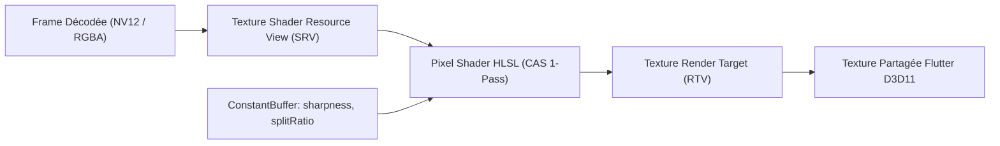

# Plan d'Implémentation 03 — Shaders Vidéo (AMD CAS / FidelityFX) & DSP Audio

## 1. Contexte & Alignement avec `mon-projet-spec`

Dans votre projet IPTV ([`D:\IptvMediacenterJaps\mon-projet-spec`](file:///D:/IptvMediacenterJaps/mon-projet-spec/lib/features/player/domain/models/video_enhancement_mode.dart)), vous avez établi une architecture de référence pour le post-traitement vidéo :
- **`VideoEnhancementMode.ecoCas`** : AMD Contrast Adaptive Sharpening (1-Pass ultra-léger, 0 Mo de RAM, idéal GPU intégré).
- **`VideoEnhancementMode.cinemaFsr`** : Rehaussement cinématique de détails et micro-contrastes.
- **Réglages fins** : Intensité de netteté (`sharpness`), et mode comparatif avant/après en écran scindé (`isSplitScreenDemo` / `splitScreenRatio`).

L'objectif de ce plan est de **porter cette même excellence dans OnionBit-Explorer**, en complétant le traitement d'image par un **DSP audio intelligent** pour les dialogues.

---

## 2. Volet Vidéo : Shaders HLSL Direct3D 11 (AMD CAS)

### 2.1. Pourquoi AMD CAS est idéal sur le Web ?
Les vidéos web (YouTube 720p/1080p, Twitch) souffrent souvent d'un flou causé par la compression H.264/VP9. 
- Les filtres de netteté traditionnels provoquent du bruit de fond et des artefacts blancs criards autour des bords.
- **L'algorithme CAS (Contrast Adaptive Sharpening)** d'AMD calcule la dérivée locale du contraste : il n'applique l'accentuation que là où se trouvent de vrais détails visuels, laissant intactes les zones planes et le grain naturel du film.
- **Coût GPU nul** : 1-Pass (une seule lecture, un seul calcul par pixel, aucune allocation de mémoire tampon intermédiaire).

### 2.2. Intégration dans le Pipeline D3D11 (`onioncodec-hw-d3d11`)



1. **Shader HLSL (`crates/onioncodec-hw-d3d11/src/shaders/cas.hlsl`)** :
   ```hlsl
   cbuffer EnhancementParams : register(b0) {
       float Sharpness;       // 0.0 (neutre) à 1.0 (fort)
       float SplitScreenRatio;// 0.0 à 1.0 (si mode démo actif)
       int   IsSplitScreen;   // 0 ou 1
       float Padding;
   };

   // Implémentation officielle AMD FidelityFX CAS 1-pass
   float4 PS_CAS(PS_INPUT input) : SV_Target {
       if (IsSplitScreen && input.uv.x > SplitScreenRatio) {
           // Côté droit : rendu brut sans traitement (pour comparaison)
           return VideoTexture.Sample(LinearSampler, input.uv);
       }
       // Côté gauche : calcul de l'accentuation adaptative CAS
       // [Formule AMD CAS sur 5 points en croix : centre + haut/bas/gauche/droite]
       return ApplyContrastAdaptiveSharpening(input.uv, Sharpness);
   }
   ```

2. **Câblage FFI** :
   ```rust
   #[unsafe(no_mangle)]
   pub extern "C" fn onionmedia_set_video_enhancement(
       player: *mut c_void,
       mode: u32,             // 0=off, 1=ecoCas, 2=cinemaFsr
       sharpness: f32,        // 0.0 .. 1.0
       is_split_screen: i32,  // 0 ou 1
       split_ratio: f32,      // 0.0 .. 1.0
   ) -> i32
   ```

---

## 3. Volet Audio : DSP Vocal & Normalisation Dynamique

### 3.1. Le Problème sur le Web
Sur YouTube et Twitch, le mixage audio est souvent chaotique :
- La musique de fond couvre les voix des créateurs.
- Les chuchotements sont inaudibles et les explosions/jingles publicitaires sont assourdissants.
- Le niveau sonore varie violemment d'une vidéo à la suivante.

### 3.2. Architecture du DSP dans `onionmedia-audio`

Le crate [`onionmedia-audio`](file:///C:/Onion-explorer-media/crates/onionmedia-audio/src/lib.rs) reçoit des trames PCM flottantes (`&[f32]`) à la sortie des décodeurs (AAC, Opus, MP3). Nous insérons deux processeurs légers avant le buffer audio :

1. **Filtre "Voice Boost" (Clarté des Voix)** :
   - Égaliseur paramétrique centré sur la bande de présence vocale humaine (**1 kHz - 3.5 kHz**, gain de +3 dB, Q = 1.2).
   - Filtre passe-haut à 80 Hz pour éliminer les grondements parasites de micro (effet de souffle/pop).

2. **Compresseur de Dynamique & Limiteur Électronique (EBU R128)** :
   - Écrase doucement les écarts extrêmes : remonte le niveau des passages chuchotés sans jamais saturer ni distordre sur les bruits forts.
   - Rend l'écoute confortable sur haut-parleurs de PC portable ou écouteurs, sans devoir toucher constamment au bouton de volume.

---

## 4. Interface Utilisateur dans OnionBit-Explorer

Dans le volet de contrôle vidéo de l'explorateur (popover ou barre inférieure) :

```
┌────────────────────────────────────────────────────────┐
│               ✨ Qualité Image & Son                   │
├────────────────────────────────────────────────────────┤
│  Netteté Vidéo (AMD CAS)   [  DÉSACTIVÉ  |  ACTIF  ]  │
│  Force :                   ━━━━━●━━━━━━━━━ 50%         │
│  Mode comparatif scindé :  [✓] Écran partagé (50/50)   │
├────────────────────────────────────────────────────────┤
│  Clarté des Voix           [  DÉSACTIVÉ  |  ACTIF  ]  │
│  Nivellement du volume     [✓] Normalisation EBU R128  │
└────────────────────────────────────────────────────────┘
```

---

## 5. Feuille de Route

- [ ] **Étape 1** : Compiler le pixel shader `cas.hlsl` en bytecode fxc dans `onioncodec-hw-d3d11`.
- [ ] **Étape 2** : Ajouter le ConstantBuffer et la passe de post-process dans le swapchain D3D11.
- [ ] **Étape 3** : Exposer `onionmedia_set_video_enhancement` dans `onionmedia-ffi`.
- [ ] **Étape 4** : Implémenter le compresseur/EQ vocal dans `onionmedia-audio` + toggle FFI.
- [ ] **Étape 5** : Réutiliser le modèle `VideoEnhancementSettings` issu de `mon-projet-spec` dans le widget Flutter de lecture.
