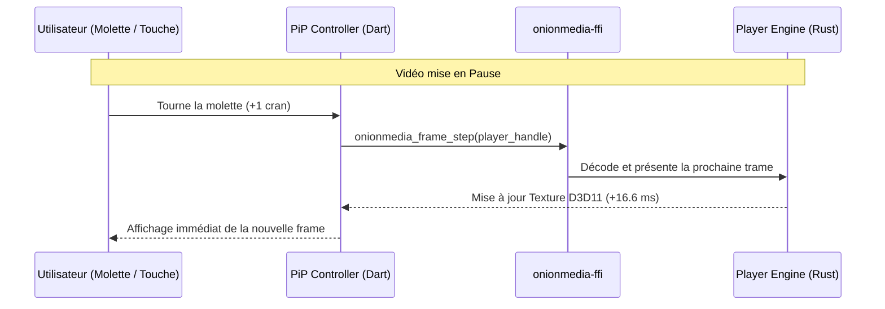

# Plan d'Implémentation 04 — Picture-in-Picture (PiP) & Avance Image par Image

## 1. Contexte & Limites des Navigateurs Actuels

Le mode "Picture-in-Picture" (fenêtre flottante) proposé par Chrome, Edge ou Safari est resté très sommaire :
- Une simple fenêtre découpée avec 2 ou 3 boutons basiques (Play, Pause, retour à l'onglet).
- Les **sous-titres disparaissent souvent** ou s'affichent mal.
- Il est impossible de naviguer finement : aucun moyen d'avancer au ralenti ou d'analyser une scène.
- La vitesse de lecture n'est pas modifiable depuis la vignette.

### Les Atouts d'OnionMedia & OnionBit-Explorer
Dans notre stack :
1. **Les symboles d'avance/recul d'une seule trame sont DÉJÀ compilés et disponibles dans la DLL** :
   - [`onionmedia_frame_step(player)`](file:///C:/Onion-explorer-media/crates/onionmedia-ffi/src/lib.rs) : avance d'exactement 1 trame.
   - [`onionmedia_frame_back_step(player)`](file:///C:/Onion-explorer-media/crates/onionmedia-ffi/src/lib.rs) : recule d'exactement 1 trame.
2. Le moteur de sous-titres [`onionmedia-sub`](file:///C:/Onion-explorer-media/crates/onionmedia-sub/src/lib.rs) décode nativement les formats WebVTT, SRT et ASS.
3. L'architecture Flutter sur Windows permet de créer des overlays flottants sans bordure (`always_on_top`) avec ombres douces et transitions fluides.

---

## 2. Spécification Fonctionnelle

```
┌────────────────────────────────────────────────────────┐
│  [🧅 PiP - Vidéo YouTube]                      [_] [X] │
├────────────────────────────────────────────────────────┤
│                                                        │
│                  [ Image Vidéo HD ]                    │
│                                                        │
│           [ CC : Sous-titre WebVTT incrusté ]          │
│                                                        │
├────────────────────────────────────────────────────────┤
│  [⏮ -1f] [ ⏯ Play ] [⏭ +1f]   (Molette : ±1 frame)  │
│  ━━━━━━●━━━━━━━━━━━━━━━━━━━━━━━━━━━━━ 03:24 / 12:40   │
│  Vitesse : [0.5x] [1.0x] [1.5x] [2.0x]     [🔊 80%]   │
└────────────────────────────────────────────────────────┘
```

1. **Bascule en PiP d'un clic** :
   - Bouton flottant sur le lecteur vidéo ou raccourci clavier universel (`Touche P`).
   - La vidéo quitte sa place dans la page web et s'ancre dans une vignette flottante élégante au coin de l'écran.
   - La vignette reste visible au-dessus de toutes les applications Windows (Word, Excel, jeux, code).

2. **Navigation Image par Image Ultra-Précise (Exclusivité)** :
   - Quand la vidéo est en pause :
     - **Molette de la souris vers le haut** ou touche `Flèche Droite` $\rightarrow$ avance d'exactement **1 frame** (ex. 16.6 ms en 60fps).
     - **Molette de la souris vers le bas** ou touche `Flèche Gauche` $\rightarrow$ recul d'exactement **1 frame**.
   - Indispensable pour :
     - Analyser un geste technique de sport ou danse.
     - Étudier un tutoriel vidéo ou une manœuvre de jeu vidéo.
     - Examiner une transition ou une animation image par image.

3. **Incrustation Parfaite des Sous-Titres** :
   - Les sous-titres WebVTT continuent d'être projetés directement au bas de la vignette PiP avec un fond sombre semi-transparent et police lisible.

4. **Contrôle Fin de la Vitesse avec Maintien de la Tonalité** :
   - Accélération de 0.25× à 4.0× sans effet "voix de canard" (grâce à l'algorithme time-stretch WSOLA de `onionmedia-audio`).

---

## 3. Architecture Technique

### 3.1. Gestion de la Fenêtre Flottante Flutter
Deux approches possibles sous Flutter Windows :
1. **Approche Sous-Fenêtre Indépendante (Recommandée)** :
   - Utilisation du package `desktop_multi_window` ou `window_manager`.
   - Création d'une fenêtre OS secondaire transparente, sans barre de titre (`titleBarStyle: hidden`), marquée `alwaysOnTop: true`.
   - La texture Direct3D 11 du lecteur média est partagée ou réassignée à la fenêtre PiP.
2. **Approche Overlay Écran Interne** :
   - Mode vignette draggable à l'intérieur de la fenêtre du navigateur (dockable dans n'importe quel coin).

### 3.2. Câblage FFI pour le Pas-à-Pas
Le flux de commandes est déjà prêt côté FFI :



---

## 4. Feuille de Route d'Implémentation

### Phase 1 : Câblage du Frame-Stepping
- [ ] Dans `onionmedia_media_player.dart`, ajouter les méthodes :
  ```dart
  void stepForward() => _frameStep?.call(_h);
  void stepBackward() => _frameBackStep?.call(_h);
  ```
- [ ] Mapper la molette de la souris et les touches fléchées lorsque le player est en pause.

### Phase 2 : Création de la Fenêtre Flottante PiP
- [ ] Configurer la fenêtre flottante détachée avec `window_manager` (gestion du ratio d'aspect, du snap aux bords d'écran).
- [ ] Migrer la texture vidéo vers la fenêtre PiP sans redémarrage de lecture.

### Phase 3 : Contrôles Enrichis et Sous-Titres
- [ ] Intégrer les boutons $\pm 1$ frame dans les contrôles du PiP.
- [ ] Assurer la projection du flux de sous-titres WebVTT dans l'overlay PiP.
- [ ] Ajouter le sélecteur de vitesse de lecture.

---

## 5. Valeur Produit
Cette fonctionnalité transforme le navigateur en un **véritable banc de montage et de visionnage de précision**, transformant une expérience de streaming passive en un outil d'analyse interactif haut de gamme.
