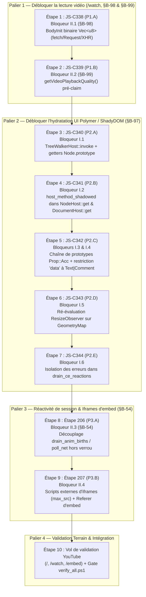

# Roadmap Complète d'Exécution — Correctifs YouTube (10 Bloqueurs, P1 → P2 → P3)

> [!IMPORTANT]
> **Environnement d'exécution verrouillé (`AGENTS.md` §10.3)**
> - **Worktree** : `C:\OninionBit-Explorer-YoutubeFix`
> - **Branche** : `nav/youtube-fix` (basée sur `main` @ `b2340042`)
> - **Isolation Cargo** : `$env:CARGO_TARGET_DIR = "D:/cargo-target/OninionBit-Explorer-YoutubeFix"`
> - **Discipline de livraison (`AGENTS.md` §4 & §5)** : **1 étape = 1 commit atomique** incluant le code, les tests de non-régression (rouges avant, verts après), l'entrée dans [`CHANGELOG.md`](file:///C:/OninionBit-Explorer-YoutubeFix/CHANGELOG.md) et la case cochée dans [`docs/roadmap-equipe-navigateur.md`](file:///C:/OninionBit-Explorer-YoutubeFix/docs/roadmap-equipe-navigateur.md).

---

## 1. Vue d'ensemble et Graphe d'Exécution



---

## 2. Matrice de Traçabilité (10 Bloqueurs ↔ Étapes ↔ Fichiers)

| Priorité | ID Étape | Bloqueur résolu | Réf. Synthèse | Crates & Fichiers modifiés | Test de verrouillage dédié |
|---|---|---|---|---|---|
| **P1.A** | **`JS-C338`** | **Bloqueur II.1** : `fetch`/`Request`/`XHR` corrompt `Uint8Array`/`ArrayBuffer` en texte CSV → `sabr.malformed_config` | `§B-98` | [`xhr.rs`](file:///C:/OninionBit-Explorer-YoutubeFix/crates/explorer-jscore/src/xhr.rs), [`worker.rs`](file:///C:/OninionBit-Explorer-YoutubeFix/crates/explorer-jscore/src/worker.rs), [`dom_host.rs`](file:///C:/OninionBit-Explorer-YoutubeFix/crates/explorer-jscore/src/dom_host.rs), [`explorer-js/src/lib.rs`](file:///C:/OninionBit-Explorer-YoutubeFix/crates/explorer-js/src/lib.rs), [`session/net.rs`](file:///C:/OninionBit-Explorer-YoutubeFix/crates/explorer-core/src/session/net.rs), [`session/net_items.rs`](file:///C:/OninionBit-Explorer-YoutubeFix/crates/explorer-core/src/session/net_items.rs), [`session/navigate.rs`](file:///C:/OninionBit-Explorer-YoutubeFix/crates/explorer-core/src/session/navigate.rs) | `crates/explorer-jscore/tests/xhr.rs` + `crates/explorer-js/tests/adapter.rs` |
| **P1.B** | **`JS-C339`** | **Bloqueur II.2** : `video.getVideoPlaybackQuality()` renvoie `undefined` hors-claim → crash `droppedVideoFrames` | `§B-99` | [`dom_host.rs`](file:///C:/OninionBit-Explorer-YoutubeFix/crates/explorer-jscore/src/dom_host.rs#L8710-L8769) | `crates/explorer-jscore/tests/media_events.rs` |
| **P2.A** | **`JS-C340`** | **Bloqueur I.1** : `TreeWalkerHost::invoke` ignore `d.cur` (`firstChild` renvoie `<html>`) + absence de getters natifs sur `Node.prototype` | `§B-97` (1) | [`misc_apis.rs`](file:///C:/OninionBit-Explorer-YoutubeFix/crates/explorer-jscore/src/misc_apis.rs#L1598-L1632), [`dom_host.rs`](file:///C:/OninionBit-Explorer-YoutubeFix/crates/explorer-jscore/src/dom_host.rs#L3714-L3742) | `crates/explorer-jscore/tests/c340_treewalker_shadydom.rs` |
| **P2.B** | **`JS-C341`** | **Bloqueur I.2** : `NodeHost::get` / `DocumentHost::get` ignorent `host_method_shadowed` → `P.appendChild(P)` lève `HierarchyRequestError` | `§B-97` (2) | [`dom_host.rs`](file:///C:/OninionBit-Explorer-YoutubeFix/crates/explorer-jscore/src/dom_host.rs#L4610-L4617) (lignes 4610 et 7440) | `crates/explorer-jscore/tests/c341_shadow_proto_methods.rs` |
| **P2.C** | **`JS-C342`** | **Bloqueurs I.3 & I.4** : `NodeHost::get`/`set` ignorent `Prop::Acc` sur la chaîne de prototypes + `el.data` renvoie `null` sur tout `Element` | `§B-97` (3, 4) | [`dom_host.rs`](file:///C:/OninionBit-Explorer-YoutubeFix/crates/explorer-jscore/src/dom_host.rs#L6539-L6543) (lignes 6539, 6994, 7528) | `crates/explorer-jscore/tests/c342_node_proto_accessors.rs` |
| **P2.D** | **`JS-C343`** | **Bloqueur I.5** : `ResizeObserver` jamais ré-évalué après `set_geometry` → `containerWidth = 0`, `shownItems = []` | `§B-97` (5) | [`observers.rs`](file:///C:/OninionBit-Explorer-YoutubeFix/crates/explorer-jscore/src/observers.rs#L46-L256) | `crates/explorer-jscore/tests/c343_resize_observer_geometry.rs` |
| **P2.E** | **`JS-C344`** | **Bloqueur I.6** : `drain_ce_reactions` perd la file restante au 1er `Err(JsError)` | `§B-97` (6) | [`dom_host.rs`](file:///C:/OninionBit-Explorer-YoutubeFix/crates/explorer-jscore/src/dom_host.rs#L10729-L10755) | `crates/explorer-jscore/tests/c344_ce_reactions_resilience.rs` |
| **P3.A** | **`Étape 206`** | **Bloqueur II.3** : Gel de 128,7 s sous verrou `Session` (`drain_anim_births` déclenchant `poll_net` synchrone sur `desktop_polymer.js`) | `§B-54` | [`session/js_glue.rs`](file:///C:/OninionBit-Explorer-YoutubeFix/crates/explorer-core/src/session/js_glue.rs#L673-L736), [`session/net.rs`](file:///C:/OninionBit-Explorer-YoutubeFix/crates/explorer-core/src/session/net.rs#L1562-L1614) | `crates/explorer-core/src/session/tests.rs` |
| **P3.B** | **`Étape 207`** | **Bloqueur II.4** : `<script src>` externes ignorés dans les `<iframe>` (`max_src = 0`) | `§B-99` (embed) | [`session/js_glue.rs`](file:///C:/OninionBit-Explorer-YoutubeFix/crates/explorer-core/src/session/js_glue.rs#L1764-L1787) | `crates/explorer-core/src/session/tests.rs` |

---

## 3. Plan Détaillé Étape par Étape

---

### PALIER 1 — Débloquer la lecture vidéo (`/watch`, `§B-98` & `§B-99`)

#### Étape 1 — `JS-C338` (`P1.A`) : Corps binaires `BodyInit` (`Uint8Array` / `ArrayBuffer` / `DataView` / `Blob`) et transport `Option<Vec<u8>>`

- **Bloqueur résolu** : **Bloqueur II.1 (`§B-98`)** — `html5player` (`base.js`) envoie son payload protobuf `VideoPlaybackAbrRequest` (`Uint8Array`) via `fetch(new Request(googlevideoUrl, { method: 'POST', body: u8 }))`. `body_init_text` convertissait le `Uint8Array` via `to_js_string` en chaîne CSV ASCII (`"120,0,255,..."`), et le canal `XhrRequest.body` / `NetRequest::Fetch.body` tronquait en UTF-8 lossy (`Option<String>`), provoquant le rejet `SabrError { type: "sabr.malformed_config" }` (UMP part `44`) et le basculement sur `/watch?v=jNQXAC9IVRw&pbj=1` (page JSON brute).
- **Fichiers & symboles à modifier** :
  1. [`crates/explorer-jscore/src/xhr.rs`](file:///C:/OninionBit-Explorer-YoutubeFix/crates/explorer-jscore/src/xhr.rs) :
     - [`XhrRequest::body`](file:///C:/OninionBit-Explorer-YoutubeFix/crates/explorer-jscore/src/xhr.rs#L72) : changer `pub body: Option<String>` en `pub body: Option<Vec<u8>>`.
     - Remplacer [`body_init_text`](file:///C:/OninionBit-Explorer-YoutubeFix/crates/explorer-jscore/src/xhr.rs#L2037-L2071) par `body_init_bytes(e: &mut Engine, v: Value) -> JsResult<(Vec<u8>, Option<String>)>` :
       - `if let Some(bytes) = crate::typed_array::bytes_of_value(e, v)` → `Ok((bytes, None))` (couvre `ArrayBuffer`, toutes les vues `TypedArray` avec `byteOffset`/`byteLength`, et `DataView`).
       - `if let Some((data, ty)) = crate::files::blob_parts(e, v)` → `Ok((data, if ty.is_empty() { None } else { Some(ty) }))` (fin de la perte UTF-8 lossy sur `Blob`/`File`).
       - `FormData` / `URLSearchParams` → `(encode(&pairs).into_bytes(), Some(...))`.
       - Autre valeur → `(e.to_js_string(v)?.into_bytes(), None)`.
     - Mettre à jour les 4 sites d'appel dans `xhr.rs` :
       - `XhrHost::invoke("send")` ([lignes 720-768](file:///C:/OninionBit-Explorer-YoutubeFix/crates/explorer-jscore/src/xhr.rs#L720-L768))
       - `request_ctor` ([lignes 1761-1774](file:///C:/OninionBit-Explorer-YoutubeFix/crates/explorer-jscore/src/xhr.rs#L1761-L1774))
       - `response_ctor` ([lignes 1886-1892](file:///C:/OninionBit-Explorer-YoutubeFix/crates/explorer-jscore/src/xhr.rs#L1886-L1892))
       - `fetch_fn` : copie directe `req.body = Some(b)` depuis `fetch_body_of(e, input)` ([lignes 2129-2136](file:///C:/OninionBit-Explorer-YoutubeFix/crates/explorer-jscore/src/xhr.rs#L2129-L2136)) et depuis `opts.body` ([lignes 2185-2199](file:///C:/OninionBit-Explorer-YoutubeFix/crates/explorer-jscore/src/xhr.rs#L2185-L2199)).
  2. [`crates/explorer-jscore/src/dom_host.rs`](file:///C:/OninionBit-Explorer-YoutubeFix/crates/explorer-jscore/src/dom_host.rs#L12924-L12936) :
     - Dans `nav_send_beacon`, extraire `body` via `crate::xhr::body_init_bytes(e, v)` (ou `into_bytes()`).
  3. [`crates/explorer-jscore/src/worker.rs`](file:///C:/OninionBit-Explorer-YoutubeFix/crates/explorer-jscore/src/worker.rs#L99-L101) :
     - [`WorkerNetRequest::body`](file:///C:/OninionBit-Explorer-YoutubeFix/crates/explorer-jscore/src/worker.rs#L100) : passer `pub body: Option<String>` à `pub body: Option<Vec<u8>>`.
  4. [`crates/explorer-js/src/lib.rs`](file:///C:/OninionBit-Explorer-YoutubeFix/crates/explorer-js/src/lib.rs#L160-L162) :
     - [`NetRequest::Fetch::body`](file:///C:/OninionBit-Explorer-YoutubeFix/crates/explorer-js/src/lib.rs#L161) : passer `body: Option<String>` à `body: Option<Vec<u8>>`.
  5. [`crates/explorer-core/src/session/net_items.rs`](file:///C:/OninionBit-Explorer-YoutubeFix/crates/explorer-core/src/session/net_items.rs#L2585-L2595), [`crates/explorer-core/src/session/net.rs`](file:///C:/OninionBit-Explorer-YoutubeFix/crates/explorer-core/src/session/net.rs#L552-L605) et [`crates/explorer-core/src/session/navigate.rs`](file:///C:/OninionBit-Explorer-YoutubeFix/crates/explorer-core/src/session/navigate.rs#L1740-L1825) :
     - `HeldFetch::body: Option<Vec<u8>>`.
     - `script_request(..., body: Option<&[u8]>, ...)` → `body: body.map(|b| b.to_vec())`.
- **Tests de verrouillage à ajouter** :
  - Dans [`crates/explorer-jscore/tests/xhr.rs`](file:///C:/OninionBit-Explorer-YoutubeFix/crates/explorer-jscore/tests/xhr.rs) :
    - `c338_fetch_and_xhr_preserve_binary_body_init` : vérifie que `fetch(url, {method:'POST', body: new Uint8Array([0x78, 0x00, 0xff, 0x80])})`, `fetch(new Request(url, {method:'POST', body: new Uint8Array(ab, 2, 4)}))`, `xhr.send(new ArrayBuffer(...))` et `new Response(new Uint8Array([0xfe, 0xff])).arrayBuffer()` livrent exactement les octets `[0x78, 0x00, 0xff, 0x80]` sans stringify `"120,0,255,128"` ni remplacement `0xEF 0xBF 0xBD`.
  - Adapter les assertions de type `Option<Vec<u8>>` dans [`crates/explorer-js/tests/adapter.rs`](file:///C:/OninionBit-Explorer-YoutubeFix/crates/explorer-js/tests/adapter.rs) et [`crates/explorer-core/src/session/tests.rs`](file:///C:/OninionBit-Explorer-YoutubeFix/crates/explorer-core/src/session/tests.rs).
- **Commandes de validation** :
  ```powershell
  $env:CARGO_TARGET_DIR = "D:/cargo-target/OninionBit-Explorer-YoutubeFix"
  cargo test -p explorer-jscore --test xhr
  cargo test -p explorer-js --test adapter
  cargo test -p explorer-core
  cargo clippy --workspace --all-targets -- -D warnings
  ```
- **Commit dédié** : `fix(jscore+js+core): JS-C338 — corps binaires BodyInit Vec<u8> sur fetch/Request/XHR (mur §B-98)`

---

#### Étape 2 — `JS-C339` (`P1.B`) : `getVideoPlaybackQuality()` disponible hors-claim sur `<video>`

- **Bloqueur résolu** : **Bloqueur II.2 (`§B-99`)** — Dans [`NodeHost::invoke`](file:///C:/OninionBit-Explorer-YoutubeFix/crates/explorer-jscore/src/dom_host.rs#L8710-L8769), lorsque l'élément `<video>` n'est pas encore dans `dom.media` (pré-claim MSE ou élément créé en mémoire par le player), le `match key` omet `"getVideoPlaybackQuality"` et tombe dans `_ => Ok(Some(Value::Undefined))`. Le watchdog de `base.js` exécute `video.getVideoPlaybackQuality().droppedVideoFrames` et crashe avec `TypeError: cannot read 'droppedVideoFrames' of Undefined`.
- **Fichier & symbole à modifier** :
  - [`crates/explorer-jscore/src/dom_host.rs`](file:///C:/OninionBit-Explorer-YoutubeFix/crates/explorer-jscore/src/dom_host.rs#L8758-L8768) :
    - Ajouter le bras `"getVideoPlaybackQuality"` dans le bloc non-claimé de `NodeHost::invoke` (juste après `"fastSeek"`) renvoyant un objet neuf `{ creationTime: 0, totalVideoFrames: 0, droppedVideoFrames: 0, corruptedVideoFrames: 0, totalFrameDelay: 0 }`, identique au contrat de `JS-C334` quand `frame_stats` est `None`.
- **Test de verrouillage à ajouter** :
  - Dans [`crates/explorer-jscore/tests/media_events.rs`](file:///C:/OninionBit-Explorer-YoutubeFix/crates/explorer-jscore/tests/media_events.rs) :
    - `c339_video_playback_quality_unclaimed_returns_zero_object` : vérifie que `document.createElement('video').getVideoPlaybackQuality()` (hors de tout `set_media_claim`) renvoie un objet non-`undefined` avec `droppedVideoFrames === 0`, `totalVideoFrames === 0`, `corruptedVideoFrames === 0`.
- **Commandes de validation** :
  ```powershell
  $env:CARGO_TARGET_DIR = "D:/cargo-target/OninionBit-Explorer-YoutubeFix"
  cargo test -p explorer-jscore --test media_events
  cargo clippy -p explorer-jscore --all-targets -- -D warnings
  ```
- **Commit dédié** : `fix(jscore): JS-C339 — getVideoPlaybackQuality() servi hors-claim sur <video> (mur §B-99)`

---

### PALIER 2 — Débloquer l'hydratation UI Polymer / ShadyDOM (`§B-97`)

#### Étape 3 — `JS-C340` (`P2.A`) : `TreeWalkerHost::invoke` stateful sur `currentNode` + getters de parcours sur `Node.prototype`

- **Bloqueur résolu** : **Bloqueur I.1 (`§B-97` #1)** — Le polyfill ShadyDOM de YouTube (`desktop_polymer.js`) inspecte `Object.getOwnPropertyDescriptor(Node.prototype, 'firstChild')` ; le descripteur étant `undefined`, il bascule sur son fallback `TreeWalker`. Or [`TreeWalkerHost::invoke`](file:///C:/OninionBit-Explorer-YoutubeFix/crates/explorer-jscore/src/misc_apis.rs#L1598-L1632) ignore `d.cur` sur `"firstChild"` (et appelle `tw_step` depuis `d.root`, c.-à-d. `document`, renvoyant toujours `<html>`) et renvoie `Value::Null` en dur pour `"lastChild"`, `"nextSibling"`, `"previousSibling"` et `"parentNode"`. ShadyDOM croit alors que `<html>` est le `firstChild` de `<ytd-app>` et exécute `ytdApp.removeChild(<html>)` → `NotFoundError: Node.removeChild: child not found`, tuant `attachShadow` et tout le rendu Polymer.
- **Fichiers & symboles à modifier** :
  1. [`crates/explorer-jscore/src/misc_apis.rs`](file:///C:/OninionBit-Explorer-YoutubeFix/crates/explorer-jscore/src/misc_apis.rs#L1598-L1632) :
     - Implémenter les 5 méthodes directionnelles de `TreeWalkerHost::invoke` (`"parentNode"`, `"firstChild"`, `"lastChild"`, `"previousSibling"`, `"nextSibling"`) à partir de `self.0.borrow().cur` (résolu en `NodeId` via `node_id_of`), en bornant le parcours au sous-arbre `root` (`cur != root` pour `parentNode`/`previousSibling`/`nextSibling`), en appliquant `tw_accept` (`whatToShow` + `filter`), et en mettant à jour `self.0.borrow_mut().cur = w` lorsqu'un nœud est accepté.
  2. [`crates/explorer-jscore/src/dom_host.rs`](file:///C:/OninionBit-Explorer-YoutubeFix/crates/explorer-jscore/src/dom_host.rs#L3714-L3742) :
     - Lors de la construction de `node_proto` / `elem_proto` dans `install_dom`, installer des descripteurs accesseurs (`Prop::Acc`) configurables sur `Node.prototype` (`parentNode`, `firstChild`, `lastChild`, `previousSibling`, `nextSibling`, `childNodes`, `textContent`, `nodeValue`) et sur `Element.prototype` (`firstElementChild`, `lastElementChild`, `nextElementSibling`, `previousElementSibling`, `children`, `innerHTML`) afin que `Object.getOwnPropertyDescriptor(Node.prototype, 'firstChild').get` retourne une fonction native utilisable par ShadyDOM (`descriptors.js`) en mode rapide sans `TreeWalker`.
- **Test de verrouillage à ajouter** :
  - Nouveau fichier [`crates/explorer-jscore/tests/c340_treewalker_shadydom.rs`](file:///C:/OninionBit-Explorer-YoutubeFix/crates/explorer-jscore/tests/c340_treewalker_shadydom.rs) :
    - `treewalker_traverses_relative_to_current_node` : crée `document.createTreeWalker(document, 1, null)`, pose `tw.currentNode = div`, vérifie que `tw.firstChild()`, `tw.lastChild()`, `tw.nextSibling()`, `tw.previousSibling()`, `tw.parentNode()` parcourent relativement à `div` (et ne renvoient jamais `document.documentElement` quand `div` est vide).
    - `node_prototype_exposes_traversal_getters` : vérifie que `Object.getOwnPropertyDescriptor(Node.prototype, 'firstChild').get.call(div)` fonctionne comme dans ShadyDOM.
- **Commandes de validation** :
  ```powershell
  $env:CARGO_TARGET_DIR = "D:/cargo-target/OninionBit-Explorer-YoutubeFix"
  cargo test -p explorer-jscore --test c340_treewalker_shadydom
  cargo test -p explorer-jscore --test dom
  cargo clippy -p explorer-jscore --all-targets -- -D warnings
  ```
- **Commit dédié** : `fix(jscore): JS-C340 — TreeWalker relatif à currentNode et getters Node.prototype (mur §B-97 #1)`

---

#### Étape 4 — `JS-C341` (`P2.B`) : Respect de `host_method_shadowed` dans `NodeHost::get` et `DocumentHost::get`

- **Bloqueur résolu** : **Bloqueur I.2 (`§B-97` #2)** — ShadyDOM installe un `appendChild` personnalisé sur `ShadowRoot.prototype` (`ShadyRoot.prototype`) et appelle `P.appendChild(P)` dans `_attachDom` pour déclencher la composition des `<slot>`. Mais [`NodeHost::get`](file:///C:/OninionBit-Explorer-YoutubeFix/crates/explorer-jscore/src/dom_host.rs#L7440-L7447) et [`DocumentHost::get`](file:///C:/OninionBit-Explorer-YoutubeFix/crates/explorer-jscore/src/dom_host.rs#L4610-L4617) interceptent `is_node_method(key)` / `is_document_method(key)` et renvoient `e.host_method_trampoline(id, key)` **sans vérifier `!e.host_method_shadowed(id, key)`** (contrairement à `WindowHost`, `HistoryHost` et `StyleHost` qui le vérifient déjà). L'appel tombe dans le `NodeHost::invoke("appendChild")` natif qui lève `HierarchyRequestError: cannot insert a node inside itself`.
- **Fichier & symboles à modifier** :
  - [`crates/explorer-jscore/src/dom_host.rs`](file:///C:/OninionBit-Explorer-YoutubeFix/crates/explorer-jscore/src/dom_host.rs) :
    - Dans [`DocumentHost::get`](file:///C:/OninionBit-Explorer-YoutubeFix/crates/explorer-jscore/src/dom_host.rs#L4610-L4617) : remplacer `if is_document_method(key) {` par `if is_document_method(key) && !e.host_method_shadowed(id, key) {`.
    - Dans [`NodeHost::get`](file:///C:/OninionBit-Explorer-YoutubeFix/crates/explorer-jscore/src/dom_host.rs#L7440-L7447) : remplacer `if is_node_method(key) {` par `if is_node_method(key) && !e.host_method_shadowed(id, key) {`.
    - Vérifier que les méthodes installées par le moteur lui-même sur `Node.prototype` / `Element.prototype` / `Document.prototype` ne sont pas considérées comme un « shadowing auteur » par `host_method_shadowed` (seules les propriétés définies par le script ou sur un prototype dérivé tel que `ShadowRoot.prototype` ou une sous-classe Custom Element doivent shadower le trampoline).
- **Test de verrouillage à ajouter** :
  - Nouveau fichier [`crates/explorer-jscore/tests/c341_shadow_proto_methods.rs`](file:///C:/OninionBit-Explorer-YoutubeFix/crates/explorer-jscore/tests/c341_shadow_proto_methods.rs) :
    - `shadow_root_prototype_append_child_override_is_called` : reproduit `ShadowRoot.prototype.appendChild = function(x) { return 'shady'; }; const sr = host.attachShadow({mode:'open'}); sr.appendChild(sr)` → retourne `'shady'` sans lever `HierarchyRequestError`.
    - `unshadowed_node_append_child_still_calls_native` : vérifie que `div.appendChild(span)` et `Node.prototype.appendChild.call(div, span)` continuent d'appeler l'implémentation DOM native.
- **Commandes de validation** :
  ```powershell
  $env:CARGO_TARGET_DIR = "D:/cargo-target/OninionBit-Explorer-YoutubeFix"
  cargo test -p explorer-jscore --test c341_shadow_proto_methods
  cargo test -p explorer-jscore --test dom
  cargo clippy -p explorer-jscore --all-targets -- -D warnings
  ```
- **Commit dédié** : `fix(jscore): JS-C341 — NodeHost/DocumentHost respectent host_method_shadowed (mur §B-97 #2)`

---

#### Étape 5 — `JS-C342` (`P2.C`) : Résolution des accesseurs `Prop::Acc` sur la chaîne de prototypes DOM + restriction de `"data"` à `Text | Comment`

- **Bloqueurs résolus** :
  - **Bloqueur I.3 (`§B-97` #3)** — [`NodeHost::get`](file:///C:/OninionBit-Explorer-YoutubeFix/crates/explorer-jscore/src/dom_host.rs#L6539-L6543) et [`NodeHost::set`](file:///C:/OninionBit-Explorer-YoutubeFix/crates/explorer-jscore/src/dom_host.rs#L7528-L7532) ne consultent `Prop::Acc { get, set }` que sur `obj.find_own(key)` (propriété propre de l'instance) et jamais sur la chaîne `proto`. Les 21 accesseurs de `ShadowRoot.prototype` posés par ShadyDOM et tous les getters/setters réactifs des prototypes de Custom Elements Polymer (`data`, `isAttached`, `title`, `hidden`, etc.) sont court-circuités par les attributs/propriétés hôtes de `NodeHost`.
  - **Bloqueur I.4 (`§B-97` #4)** — [`NodeHost::get`](file:///C:/OninionBit-Explorer-YoutubeFix/crates/explorer-jscore/src/dom_host.rs#L6994-L7007) intercepte `"nodeValue" | "data"` sur tous les `NodeKind::Element` et renvoie `Value::Null`, alors que selon la spec DOM `data` n'existe que sur `CharacterData` (`Text | Comment`) (ce que fait déjà [`NodeHost::set` ligne 7768](file:///C:/OninionBit-Explorer-YoutubeFix/crates/explorer-jscore/src/dom_host.rs#L7768-L7785)). Sur YouTube, `el.data = { simpleText: "Accueil", trackingParams: "..." }` sur `<yt-formatted-string>` stocke l'objet, mais `this.data` relit `null` → `TypeError: cannot read 'trackingParams' of Null`.
- **Fichier & symboles à modifier** :
  - [`crates/explorer-jscore/src/dom_host.rs`](file:///C:/OninionBit-Explorer-YoutubeFix/crates/explorer-jscore/src/dom_host.rs) :
    1. Ajouter un helper `proto_accessor_of(e: &Engine, start_id: ObjId, key: &str) -> Option<(Option<ObjId>, Option<ObjId>)>` qui remonte la chaîne `proto` (avec borne de profondeur `0..32` contre les cycles) jusqu'aux prototypes de base exclus (`e.dom_state().node_proto`, `elem_proto`, `html_elem_proto`, `e.protos.object`, pour que les getters natifs de `Node.prototype` ajoutés en `JS-C340` ne bouclent pas sur eux-mêmes, tandis que `ShadowRoot.prototype` et tous les prototypes de sous-classes Custom Elements / patchs auteur soient honorés).
    2. Dans [`NodeHost::get`](file:///C:/OninionBit-Explorer-YoutubeFix/crates/explorer-jscore/src/dom_host.rs#L6539-L6543) : si ni `find_own(key)` ni `proto_accessor_of(e, id, key)` ne fournissent un `Prop::Acc`, continuer vers le switch `NodeHost` ; si un accesseur propre ou de prototype dérivé existe, l'exécuter avec `this = Value::Obj(id)`. (Si une propriété de données propre `Prop::Val` existe sur `id` pour une clé qui n'est pas un attribut réfléchi prioritaire, ou après séparation de `"data"`, la restituer.)
    3. Dans [`NodeHost::set`](file:///C:/OninionBit-Explorer-YoutubeFix/crates/explorer-jscore/src/dom_host.rs#L7528-L7532) : consulter `find_own(key)` puis `proto_accessor_of(e, id, key)` avant le switch `NodeHost` pour que toute affectation `el.prop = val` sur un Custom Element ou un `ShadowRoot` déclenche le setter du prototype Polymer/ShadyDOM.
    4. Dans [`NodeHost::get`](file:///C:/OninionBit-Explorer-YoutubeFix/crates/explorer-jscore/src/dom_host.rs#L6994-L7007) : séparer `"nodeValue"` et `"data"` :
       - `"nodeValue"` : renvoie `Some(s)` sur `Text | Comment`, `Value::Null` sur les autres `NodeKind`.
       - `"data"` : renvoie `Some(s)` uniquement si `matches!(kind, Some(NodeKind::Text(_) | NodeKind::Comment(_)))`, et `Ok(None)` sur `NodeKind::Element` / `Document` / `DocumentFragment` (laissant la lecture normale de `el.data` sur l'objet JS ou son prototype Custom Element).
- **Test de verrouillage à ajouter** :
  - Nouveau fichier [`crates/explorer-jscore/tests/c342_node_proto_accessors.rs`](file:///C:/OninionBit-Explorer-YoutubeFix/crates/explorer-jscore/tests/c342_node_proto_accessors.rs) :
    - `element_data_property_roundtrips_on_html_and_custom_elements` : vérifie que `const el = document.createElement('yt-formatted-string'); el.data = { trackingParams: 'abc' }; el.data.trackingParams === 'abc'`, tandis que `document.createTextNode('hi').data === 'hi'` et `el.nodeValue === null`.
    - `custom_element_and_shadow_root_prototype_accessors_intercept_get_and_set` : définit un getter/setter sur `ShadowRoot.prototype` et sur une classe Custom Element (`title`, `data`, `innerHTML`), vérifie que `el.title = 'x'` et `el.data = {a:1}` invoquent les setters/getters du prototype.
- **Commandes de validation** :
  ```powershell
  $env:CARGO_TARGET_DIR = "D:/cargo-target/OninionBit-Explorer-YoutubeFix"
  cargo test -p explorer-jscore --test c342_node_proto_accessors
  cargo test -p explorer-jscore --test c313_polymer_proto
  cargo test -p explorer-jscore --test dom
  cargo clippy -p explorer-jscore --all-targets -- -D warnings
  ```
- **Commit dédié** : `fix(jscore): JS-C342 — accesseurs prototypes DOM et el.data sur Element (mur §B-97 #3/#4)`

---

#### Étape 6 — `JS-C343` (`P2.D`) : Ré-évaluation des `ResizeObserver` lors des mises à jour `GeometryMap`

- **Bloqueur résolu** : **Bloqueur I.5 (`§B-97` #5)** — `<ytd-rich-grid-renderer>` observe sa taille via `ResizeObserver` pour calculer `elementsPerRow` et remplir `shownItems` à partir de `contents` (les 28 tuiles vidéo de l'accueil). Au `observe()` initial (avant layout), `clientWidth`/`offsetWidth` valent `0`. Après le premier layout, la session injecte `set_geometry(GeometryMap)` et draine `deliver_observers`. Mais [`Engine::deliver_observers`](file:///C:/OninionBit-Explorer-YoutubeFix/crates/explorer-jscore/src/observers.rs#L226-L256) ne ré-évalue que `ObsKind::Intersection` et jamais `ObsKind::Resize`, laissant `containerWidth = 0` et l'écran d'accueil vide.
- **Fichier & symboles à modifier** :
  - [`crates/explorer-jscore/src/observers.rs`](file:///C:/OninionBit-Explorer-YoutubeFix/crates/explorer-jscore/src/observers.rs) :
    - Dans [`ObsData`](file:///C:/OninionBit-Explorer-YoutubeFix/crates/explorer-jscore/src/observers.rs#L46-L65) : ajouter `pub(crate) last_size: HashMap<NodeId, (i32, i32)>` (initialisé dans `obs_new`, mis à jour dans `obs_observe` avec les dimensions initiales `target_box_size`, nettoyé dans `obs_unobserve` / `obs_disconnect`).
    - Dans [`Engine::deliver_observers`](file:///C:/OninionBit-Explorer-YoutubeFix/crates/explorer-jscore/src/observers.rs#L226-L256) : pour chaque observateur `ObsKind::Resize` actif, comparer la taille courante `(w, h)` de chaque `target` (issue de `dom.geometry` / `target_box_size`) à `last_size.get(&target)`. Si `(w, h)` a changé (ex. `(0, 0)` → `(1280, 720)` après layout), mettre à jour `last_size` et enfiler un `ResizeObserverEntry` frais via `make_ro_entry(self, target)`.
- **Test de verrouillage à ajouter** :
  - Nouveau fichier [`crates/explorer-jscore/tests/c343_resize_observer_geometry.rs`](file:///C:/OninionBit-Explorer-YoutubeFix/crates/explorer-jscore/tests/c343_resize_observer_geometry.rs) :
    - `resize_observer_fires_when_geometry_map_changes_size` : observe un élément `div` (notification initiale `0x0`), appelle `set_geometry` avec `client_width: 1200, client_height: 800`, draine les microtasks/observers → vérifie que le callback `ResizeObserver` est rappelé avec `contentRect.width === 1200` et ne re-tire pas au drain suivant si la géométrie est inchangée.
- **Commandes de validation** :
  ```powershell
  $env:CARGO_TARGET_DIR = "D:/cargo-target/OninionBit-Explorer-YoutubeFix"
  cargo test -p explorer-jscore --test c343_resize_observer_geometry
  cargo clippy -p explorer-jscore --all-targets -- -D warnings
  ```
- **Commit dédié** : `fix(jscore): JS-C343 — ResizeObserver ré-évalué sur changement de GeometryMap (mur §B-97 #5)`

---

#### Étape 7 — `JS-C344` (`P2.E`) : Isolation des erreurs par réaction dans `Engine::drain_ce_reactions`

- **Bloqueur résolu** : **Bloqueur I.6 (`§B-97` #6)** — [`Engine::drain_ce_reactions`](file:///C:/OninionBit-Explorer-YoutubeFix/crates/explorer-jscore/src/dom_host.rs#L10729-L10755) fait `std::mem::take(&mut self.dom_state_mut().ce.reactions)` puis propage la première erreur avec `?`. Si un seul Custom Element parmi 80 lève une exception dans `connectedCallback` ou dans son constructeur d'upgrade, les 79 réactions restantes du `Vec` pris par `mem::take` sont définitivement perdues.
- **Fichier & symbole à modifier** :
  - [`crates/explorer-jscore/src/dom_host.rs`](file:///C:/OninionBit-Explorer-YoutubeFix/crates/explorer-jscore/src/dom_host.rs#L10729-L10755) :
    - Dans `Engine::drain_ce_reactions`, capturer le `Result` de chaque réaction individuelle (`CeReaction::Upgrade`, `CeReaction::Connected`, `CeReaction::Disconnected`, `CeReaction::AttrChanged`), conserver la première `Err(e)` éventuelle dans `first_err: Option<JsError>` (ou la reporter sans interrompre la boucle), et continuer à drainer toutes les réactions restantes du lot avant de retourner.
- **Test de verrouillage à ajouter** :
  - Nouveau fichier [`crates/explorer-jscore/tests/c344_ce_reactions_resilience.rs`](file:///C:/OninionBit-Explorer-YoutubeFix/crates/explorer-jscore/tests/c344_ce_reactions_resilience.rs) :
    - `throwing_custom_element_reaction_does_not_drop_sibling_reactions` : insère un conteneur avec `<bad-el>` (dont `connectedCallback` throw) suivi de `<good-el>` (dont `connectedCallback` pose `this.connected = true`) ; vérifie que `<good-el>` reçoit bien son `connectedCallback` malgré l'exception de `<bad-el>`.
- **Commandes de validation** :
  ```powershell
  $env:CARGO_TARGET_DIR = "D:/cargo-target/OninionBit-Explorer-YoutubeFix"
  cargo test -p explorer-jscore --test c344_ce_reactions_resilience
  cargo clippy -p explorer-jscore --all-targets -- -D warnings
  ```
- **Commit dédié** : `fix(jscore): JS-C344 — drain_ce_reactions résilient aux erreurs individuelles (mur §B-97 #6)`

---

### PALIER 3 — Réactivité de session & Iframes d'embed (`§B-54` & `§B-99`)

#### Étape 8 — `Étape 206` (`P3.A`) : Découplage de `drain_anim_births` et `poll_net` hors du chemin synchrone post-commit

- **Bloqueur résolu** : **Bloqueur II.3 (`§B-54`)** — Dans [`Session::drain_anim_births`](file:///C:/OninionBit-Explorer-YoutubeFix/crates/explorer-core/src/session/js_glue.rs#L673-L736), le dispatch de `animationstart` appelle `dispatch_path_event_props` ([ligne 1566](file:///C:/OninionBit-Explorer-YoutubeFix/crates/explorer-core/src/session/js_glue.rs#L1566)), qui appelle immédiatement `self.poll_net()`. Si le chunk réseau de `desktop_polymer.js` (12,6 Mo) est arrivé dans le canal pendant la peinture, `poll_net()` exécute [`deliver_dyn_script`](file:///C:/OninionBit-Explorer-YoutubeFix/crates/explorer-core/src/session/net.rs#L1562-L1614) de manière synchrone sous le verrou de `Session`, bloquant toutes les routes REST (`/api/status`, `/api/tabs/{id}/frame`, `/api/tabs/{id}/eval`) pendant 128,7 s.
- **Fichiers & symboles à modifier** :
  - [`crates/explorer-core/src/session/js_glue.rs`](file:///C:/OninionBit-Explorer-YoutubeFix/crates/explorer-core/src/session/js_glue.rs#L673-L736) :
    - Dans `drain_anim_births`, drainer les requêtes réseau émises par les callbacks (`drain_script_net`) sans appeler `self.poll_net()` récursivement au milieu de la livraison des naissances d'animations CSS (la pompe principale du daemon appelle déjà `poll_net()` à son tick propre).
- **Test de verrouillage à ajouter** :
  - Dans [`crates/explorer-core/src/session/tests.rs`](file:///C:/OninionBit-Explorer-YoutubeFix/crates/explorer-core/src/session/tests.rs) :
    - `etape206_drain_anim_births_does_not_reenter_poll_net` : vérifie que `drain_anim_births` dispatche `animationstart`/`transitionend` et draine les `NetRequest` sortants sans déclencher la livraison synchrone d'un script dynamique en attente dans `net_rx`.
- **Commandes de validation** :
  ```powershell
  $env:CARGO_TARGET_DIR = "D:/cargo-target/OninionBit-Explorer-YoutubeFix"
  cargo test -p explorer-core
  cargo clippy -p explorer-core --all-targets -- -D warnings
  ```
- **Commit dédié** : `fix(core): Étape 206 — drain_anim_births sans ré-entrée synchrone poll_net (mur §B-54)`

---

#### Étape 9 — `Étape 207` (`P3.B`) : Chargement des `<script src>` externes dans les `<iframe>` (`max_src`)

- **Bloqueur résolu** : **Bloqueur II.4 (`§B-99` embed)** — Lorsqu'une page intègre `<iframe src="https://www.youtube.com/embed/...">`, [`Session::frame_context_plan`](file:///C:/OninionBit-Explorer-YoutubeFix/crates/explorer-core/src/session/js_glue.rs#L1764-L1787) appelle `collect_scripts(&f.tree, f.tree.document(), 0, &mut HashSet::new())` avec `max_src = 0`, ce qui ignore tous les `<script src="/s/player/.../www-embed-player.js">` et `<script src="/s/player/.../base.js">` de l'iframe. Le lecteur YouTube embarqué reste figé sur son spinner initial.
- **Fichier & symbole à modifier** :
  - [`crates/explorer-core/src/session/js_glue.rs`](file:///C:/OninionBit-Explorer-YoutubeFix/crates/explorer-core/src/session/js_glue.rs#L1764-L1787) (et la livraison dans `session/net.rs` / `session/navigate.rs`) :
    - Autoriser un budget borné de scripts externes par sous-cadre (`self.limits.max_external_scripts` ou budget dédié aux cadres) et câbler leur fetch/évaluation dans le `FrameCtxId` (`fc_id`) correspondant (comme pour les scripts inline de l'iframe).
- **Test de verrouillage à ajouter** :
  - Dans [`crates/explorer-core/src/session/tests.rs`](file:///C:/OninionBit-Explorer-YoutubeFix/crates/explorer-core/src/session/tests.rs) :
    - `etape207_iframe_external_scripts_execute_in_frame_ctx` : vérifie qu'une `<iframe src="https://embed.example/player.html">` contenant `<script src="https://embed.example/app.js">` télécharge et exécute `app.js` dans le `FrameCtxId` de l'iframe et synchronise ses mutations DOM dans l'arbre du cadre.
- **Commandes de validation** :
  ```powershell
  $env:CARGO_TARGET_DIR = "D:/cargo-target/OninionBit-Explorer-YoutubeFix"
  cargo test -p explorer-core
  cargo clippy -p explorer-core --all-targets -- -D warnings
  ```
- **Commit dédié** : `feat(core): Étape 207 — exécution des <script src> externes dans les iframes (mur embed YouTube)`

- **Statut** :
  - ✅ **Étape 207 livrée** (`938e42e2`) — `Dom::mark_external_scripts_pending` + `install_dom_ctx` (borne `MAX_CTX_PARSE_SCRIPTS=64`) enfilent les `<script src>` du sous-document dans `pending_dyn` ; le rail dyn-script fetch/évalue tagué **ctx enfant** sous l'identité du cadre (`ctx_net_origin` — referer = URL de l'iframe). Verrous `frame_ext_scripts` + `etape207_iframe_external_scripts_execute_in_frame_ctx` verts.
  - ⚠️ **Vol 647 (`642d9b30`) — mur déplacé : II.4-bis** — les `src=` externes étaient bien fetchés/évalués (`ytembeds.base`, `base.js`), mais les `<script>` **inline** de l'iframe évaluaient au câblage du contexte **avant** leur livraison → `ReferenceError: writeEmbed is not defined`, lecteur noir.
  - ✅ **Étape 207-bis livrée** (`2fad5311`) — tout le flux parse (`src` + inline) enfilé dans la file ordonnée du rail dyn (`defer_order`) ; `Session.ordered_dyn` sérialise par ctx (`in_flight`/`pump_ordered_dyn`), cycle `readyState`/DCL/`load` du cadre différé à la vidange de la file (spec : DCL après les scripts parseur). Verrous `frame_ext_scripts` (6) + `etape207bis_*` ; 37 canaris iframe verts.
  - ✅ **Vol 648 — II.4-bis RÉSOLU** — externes évalués avant les inline différés (`ytembeds.base` 558 Ko + `base.js` 1,9 Mo + `r78Drb` 1 Mo dans le ctx enfant), **zéro `ReferenceError`**, `raster items 5→19`, bootstrap complet → écran d'erreur player peint.
  - ⚠️ **Vol 648 — mur déplacé : II.4-ter** — `MediaSource.isTypeSupported`/`canPlayType` rendaient `""` sur tous les formats dans le ctx iframe (`declared_n=0` vs 13 au parent) : la table `declared_codecs` est garée par contexte et chaque `Context` naît vide → embed « aucun format jouable ».
  - ✅ **Étape 207-ter livrée** (`d9654d83`) — `context_new` fait hériter le realm naissant de `declared_codecs` du parent au spawn (snapshot : capacité hôte plateforme-globale ; claims ultérieurs document-locaux). Verrous `etape207ter_child_ctx_inherits_declared_codecs` + `etape207ter_iframe_sees_host_declared_codecs` ; canaris iframe (40) + suites mse/ctx verts.
  - ✅ **Vol 649 — II.4-ter RÉSOLU** — `declared_n=13` dans le ctx iframe, verdicts honnêts (`maybe` chaînes complètes, `""` non-déclaré), plus d'écran « aucun format jouable » ; bootstrap embed vivant (`player_ias` 3 Mo évalué). `media_n=0` résiduel = stall aval §B-100-famille.
  - ⚠️ **Reste §B-100 (accueil + lecture)** — cascade `unhandledrejection` + `RangeError` `base.js:10855`, `mseOffsets=[0,0]` : suspect n°1 du stall SABR et de l'hydratation inachevée.
  - ✅ **§B-95 fixé — JS-C345** (`20d041a0`) — `isTypeSupported` rend `"probably"` sur liste `codecs=` entièrement déclarée (verdict trois niveaux partagé avec `canPlayType`).
  - ✅ **§B-94 fixé — JS-C346** — alias `vp9`/`h264`/`av1`/`hevc`/`aac`/`ac-3` → famille canonique (`codec_family`, deux bords) ; `eac3`/`ec-3`/`hvc1` négatifs honnêts. **À revalider en vol** (prochaine mesure `media_probe`).

---

### PALIER 4 — Validation Terrain Live & Gate d'Intégration

#### Étape 10 — Vol de validation YouTube (`/`, `/watch`, `/embed`) & Gate `verify_all.ps1`

1. **Build release frais (`AGENTS.md` §8 — « Verdict terrain = binaire frais »)** :
   ```powershell
   $env:CARGO_TARGET_DIR = "D:/cargo-target/OninionBit-Explorer-YoutubeFix"
   cargo build --release --bin explorer-daemon
   ```
2. **Vol de vérification instrumenté sur YouTube** (avec `spawn_daemon.ps1` + `vol_joblimit.ps1` + `vol_memwatch.ps1` conformément à `docs/vol-agent.md` **et `docs/vol-youtube.md`** — protocole dédié : artefacts → `C:\OnionBit-vol\youtube\`) :
   - **Test 1 (`https://www.youtube.com`)** :
     - Vérifier `ytd-app.shadowRoot !== null` (0 `NotFoundError`, 0 `HierarchyRequestError`).
     - Vérifier que `<ytd-rich-grid-renderer>` reçoit sa géométrie (`containerWidth > 0`) et peuple ses `<ytd-rich-item-renderer>` avec titres et miniatures.
     - Capturer la frame PNG de la page d'accueil.
   - **Test 2 (`https://www.youtube.com/watch?v=jNQXAC9IVRw`)** :
     - Vérifier que les requêtes `POST https://*.googlevideo.com/videoplayback?...` partent avec les octets protobuf bruts (0 `sabr.malformed_config`, pas de redirection `/watch?v=...&pbj=1`).
     - Vérifier que `MediaSource` ouvre ses `SourceBuffer`s (`mseBuffers.length >= 1`), que `video.getVideoPlaybackQuality()` répond sans `TypeError`, et que la vidéo est offerte/jouée.
     - Capturer la frame PNG de la page `/watch`.
   - **Test 3 (`<iframe>` `/embed/jNQXAC9IVRw`)** :
     - Vérifier que l'iframe charge et exécute ses scripts externes avec `Referer` valide (pas d'`Erreur 153`).
3. **Gate complet avant fusion sur `main` (`AGENTS.md` §3 & §10.3)** :
   ```powershell
   $env:CARGO_TARGET_DIR = "D:/cargo-target/OninionBit-Explorer-YoutubeFix"
   cargo fmt --all -- --check
   cargo clippy --workspace --all-targets -- -D warnings
   cargo test --workspace
   cargo doc --workspace --no-deps
   ```
