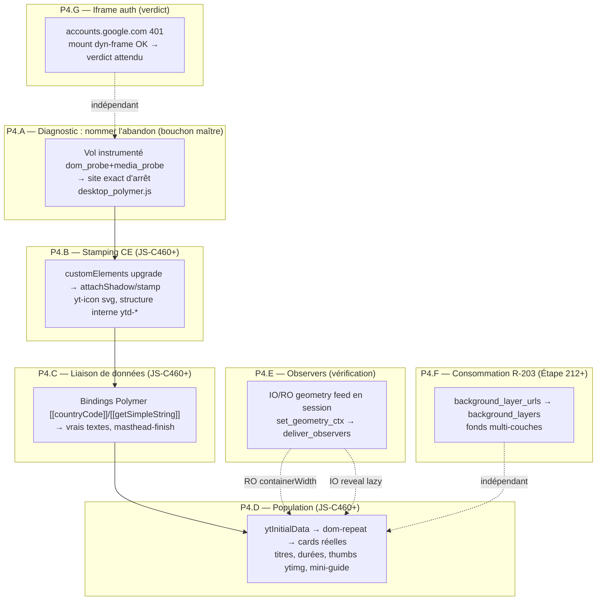

# Roadmap Palier 4 — YouTube : de la première frame hydratée à l'accueil peuplé

> Suite directe de [`roadmap_youtube_fix.md`](roadmap_youtube_fix.md)
> (P1→P3, toutes livrées). Ce document couvre la frontière
> actuelle : l'hydratation **démarre** (§B-97 tombé vol 701,
> JS-C416) mais **s'arrête à mi-chemin** — squelette SSR peint
> fidèlement, contenu jamais peuplé.

> [!IMPORTANT]
> **Environnement d'exécution verrouillé (`AGENTS.md` §10.3)**
> - **Worktree** : `C:\OninionBit-Explorer-YoutubeFix`
> - **Branche** : `nav/youtube-fix`
> - **Isolation Cargo** : `$env:CARGO_TARGET_DIR = "C:/cargo-target/OninionBit-Explorer-YoutubeFix"`
> - **Discipline (`AGENTS.md` §4 & §5)** : **1 étape = 1 commit**
>   code + verrous + `CHANGELOG.md` + case cochée dans
>   `docs/roadmap-equipe-navigateur.md`. Les étapes de
>   **diagnostic pur** (vol instrumenté, sonde seule) produisent
>   un rapport + entrée `docs/interface-equipes.md` /
>   `youtube/SYNTHESE.md`, pas de case roadmap sauf si une
>   sonde est livrée.
> - **Protocole de vol** : [`vol-youtube.md`](vol-youtube.md)
>   intégralement (batterie `EXPLORER_*` obligatoire,
>   worktree de vol `C:\OnionBit-Explorer-youtube-wt`,
>   artefacts sous `C:\OnionBit-vol\youtube\`).

---

## 0. État mesuré au départ (post-vol 701 + vol instrumenté 2026-11-09)

| Signal | État | Source |
|---|---|---|
| §B-97 hydratation | **Fermé** — `g.data`×6, `ce.define` 2 090, `ce.upgrade` 93, `el.birth` 123 vrais `ytd-*`, `ytd-rich-grid-renderer` monté, 1ʳᵉ frame hydratée | vol 701 `dcc13516` |
| Émission display list | `items=148`, `text:2`, `glyphs=17` — squelette shimmer complet et correct | vol instrumenté 2026-11-09 |
| Templates Polymer | littéraux `[[countryCode]]`/`[[getSimpleString]]` **non expansés** dans le DOM | idem |
| `yt-icon`/`ytd-*` shadow | stamp **absent** sauf hamburger → le chemin shadow→svg→image **marche** quand le stamp arrive | idem |
| `masthead-finish` | jamais posé → skeleton-icons restent | idem |
| `ytInitialData` → cards | données consommées (`g.data`) mais **cards jamais peuplées** | idem |
| `ytd-mini-guide` | contenu `64×0` (vide) ; drawer `−240px` correct (fermé) | idem |
| `/watch` | **record** : vidéo entière bufferisée, chaîne MSE à l'octet, `kevlar_base` complète 4,4 s | vol 731 `bb53e937` |
| Iframe `accounts.google.com` | `401` login passif — bénin, cosmétique | vol 731 |
| Mémoire §B-114 | résorbé en vol (gc 26 ms au vol 731) — surveillance `EXPLORER_MEM_DIAG` conservée | vols 705-731 |
| Dyn frames §B-122 | sondes `net.dfr/dfs/dfc/dfx` + anti-famine `MIN_REST_DELIVERIES` **en cours** (WIP non commité, CHANGELOG rédigé vol 776) | worktree |

**Lecture** : le mur n'est plus « l'hydratation ne part pas » —
c'est « l'hydratation **avorte en vol** ». Tout ce qui suit est
ordonné par la chaîne causale : tant que le bundle n'a pas fini
de s'exécuter, aucun stamp/binding/card ne peut s'allumer.

---

## 1. Graphe d'exécution

> **Verdict vol 733 (P4.A livré)** — l'hydratation **dépasse
> le squelette** : `dom.kill`×5 retire `home-page-skeleton`,
> `g.data`×6, `ce.define` 1045, **`/youtubei` POST→200**
> (browse émis, 1ʳᵉ fois accueil), `dlv.observers` livrés
> en session → **P4.E pré-validé**, **P4.G fermé** (401
> attendu). L'abandon est **post-mount**, nommé **§B-124** :
> `uncaught TypeError: illegal constructor (KeyframeEffect)`
> `late,app:5743:23` (stub `illegal_ctor_bound` — surface
> WAAPI absente) → **P4.B pivote : première étape =
> `KeyframeEffect` constructible** (JS-C46x), puis sonder
> le span ~8 min du consommateur `/youtubei` sans mutation
> aval.
>
> **Verdict vol 734** — JS-C461 **validé** : `illegal
> constructor` disparu, `dlv.mutations` ×5. Gate suivant
> **§B-125** : `uncaught TypeError: caller/arguments are
> restricted function properties` ×8+ → étape JS-C46x
> (`caller`/`arguments` = `null` sur fonctions non-strict,
> spec) ; span ~8 min post-`/youtubei` reconduit
> (instrumentation du consumer à prévoir).

**Ordre strict** : P4.A → P4.B → P4.C → P4.D. P4.E se vérifie en
parallèle (vérification, pas refonte) ; P4.F et P4.G sont des
coutures indépendantes — P4.G attend seulement le commit du
WIP dyn-frame en cours.

**La mesure maîtresse** : `items=148 text:2` → des centaines
d'items `text` dès que l'hydratation tient ; le littéral
`[[countryCode]]` qui disparaît du DOM est le témoin visuel
immédiat (grep du dump DOM ou `eval`).

---

## 2. Matrice de traçabilité

| Étape | Bloqueur résolu | Crates & fichiers | Verrou attendu |
|---|---|---|---|
| **P4.A** | Point d'abandon de `desktop_polymer.js` non nommé | `explorer-jscore` sondes `dom_probe` (+ nouvelle sonde bornée si besoin), protocole vol | Rapport vol + entrée SYNTHESE/journal ; sonde = commit `feat(jscore)` si ajoutée |
| **P4.B** | Stamp shadow/template jamais émis à l'upgrade (sauf hamburger) | `explorer-jscore` `dom_host.rs` (`ce_upgrade_node`, `CustomElementsHost`, `attachShadow`), `dom.rs` (`ce`, `template_contents`), `explorer-core` `session/apply.rs` (journal `AttachShadow`) | Fixture CE stamp → enfants shadow matérialisés dans le DOM réel |
| **P4.C** | Bindings `[[…]]` non évalués (property-effects, `__data`, anchors commentaires) | `explorer-jscore` `dom_host.rs` (accesseurs CE, réactions), `dom.rs` (nœuds commentaire dans `template_contents`) | Fixture template annoté → `[[x]]` expansé après flush |
| **P4.D** | `ytInitialData` consommée mais cards non peuplées (`dom-repeat`, `shownItems`) | `explorer-jscore` `dom_host.rs`/`dom.rs` + couture observers | Fixture `dom-repeat`-like ou verrou vol : `el.birth ytd-rich-item-renderer` > 0 |
| **P4.E** | Chemin geometry→observers non vérifié en session réelle | `explorer-core` `session/tab.rs` (`rebuild_geometry`), `js_glue.rs` (`set_geometry_ctx`), `explorer-jscore` `observers.rs` | Test session : callback RO/IO tiré après commit paint |
| **P4.F** | Couches `background` ≥2 fetchées mais jamais routées vers `PaintImages.background_layers` | `explorer-core` `session/apply.rs` (staging `bg_bodies`/`backgrounds`), `net_items.rs` (`fetch_backgrounds`) | Fixture 2 `url()` → les deux couches décodées et ordonnées |
| **P4.G** | Verdict iframe 401 : mount vs page d'erreur | `explorer-core` `session/net.rs` (sondes §B-122 WIP) | Rapport : `net.dfc install` sur la 401 = comportement attendu |

---

## 3. Plan détaillé

### Étape P4.A — Nommer le point exact d'abandon de l'hydratation

- **Bloqueur** : `desktop_polymer.js` (~12,6 Mo) s'exécute
  partiellement puis s'arrête — même classe de symptôme que
  pluto §B-118 (`ev.dispatch ty=error` au milieu du dispatch).
  Tant que le bundle n'a pas terminé, P4.B/C/D ne peuvent pas
  s'allumer. **C'est une étape de diagnostic, pas de code** —
  la sortie attendue est un site nommé `fichier:ligne:col` +
  l'API/le hook manquant, qui devient le bloqueur d'une étape
  JS-C460+.
- **Sondes déjà posées** (cible `dom_probe`, armées par
  `RUST_LOG=dom_probe=info`, zéro coût désarmées) :
  - `ce.define` / `ce.upgrade` / `ce.failed` /
    `ce.whenDefined` (`dom_host.rs` ~11850-12100) — le trio
    né/défini/upgradé tranche où s'arrête la cascade `ytd-*` ;
  - `el.birth` (`dom.rs` ~2081) — tags effectivement créés ;
  - `ev.new` / `ev.try` / `ev.dispatch` / `ev.cb` /
    `ev.threw` / `ev.error` (`dom_host.rs` ~4650-4900,
    ~13480, ~14184) — chaîne dispatch complète, `ev.try`
    présent + `ev.dispatch` absent = drop silencieux ;
  - `console.call` (~14910), `el.listen`/`ls.late` (~14215),
    `url.ctor.fail` (`builtins/url.rs`), `msg.drop`
    (`interp/mod.rs` ~2648) ;
  - `prom.pending`/`prom.settle`/`prom.src` (JS-C383/386/412)
    — les `.then` orphelins nomment leur fabrique `ligne:col` ;
  - `expr_bisect` (`interp/eval.rs` ~101) — dumps
    `call_depth`/`frames` en cas de soupçon de pile.
- **Côté session** : `media_probe` (`net.drq`/`net.dfs`/
  `net.dfc`/`net.held`/`net.abk` — §B-122 WIP), `EXPLORER_DLV_
  TRACE=1` (breadcrumb `journal: op`), `EmitStats` déjà
  consommé (`EXPLORER_EMIT_STATS=1`), `EXPLORER_MEM_DIAG=1`.
- **Protocole** : vol `YTHOME` standard `vol-youtube.md`
  (batterie §1.3 complète) + `RUST_LOG=dom_probe=info,
  media_probe=info`. Profil **froid**.
- **Lecture du log, dans l'ordre** :
  1. Dernier `ce.upgrade`/`el.birth` avant silence → tag du
     CE où la cascade meurt ;
  2. Premier `ev.threw`/`ev.error`/`uncaught:` après le
     dernier progrès → exception fautive + pile ;
  3. `console.call` terminaux (Polymer logue avant d'abandonner) ;
  4. `prom.pending` dominant → fabrique `.then` orpheline
     (méthode éprouvée vols 672-700 : `kevlar_base:NNNN:CC`
     → décompiler au bundle) ;
  5. `net.dfx`/`net.dfc reject` — un sous-fetch mort peut
     suspendre la fin d'hydratation.
- **Si les sondes ne suffisent pas** : une sonde bornée
  additive (premier-par-tag, `probe_seen` dédup — gabarit
  `ce.failed`) nommant le dernier site `dom_probe` émis +
  horodatage, ou un compteur `ce.reaction` par callback.
  Livrée en commit `feat(jscore): sonde hydratation …`
  avec son verrou.
- **Sortie** : entrée `youtube/SYNTHESE.md` + journal —
  mur nommé `§B-12x`, suspects éliminés listés.
- **Piège** : l'hydratation a déjà **réussi une fois**
  (vol 701) — vérifier la **variance** (≥2 runs ou
  confirmation que le HEAD courant reproduit le stall ;
  un mur probabiliste = autre classe de bug, mémoire ou
  scheduling, pas API manquante).
- **Re-baseline GC** : le vol de diagnostic se mesure sur
  un binaire **incluant JS-C46x (JT-16/17)** — le safepoint
  plus fin / churn rumble changent la signature mémoire
  mid-eval. Si le stall disparaît à ce HEAD, l'abandon
  était de classe §B-114 (mort heap probabiliste), pas un
  gap d'API — P4.A se clôt autrement et les étapes
  P4.B/C/D se jouent sur le constat du vol suivant.

---

### Étape P4.B — `customElements` upgrade → stamp (`attachShadow`/ShadyDOM)

- **Bloqueur** : à l'upgrade, chaque `yt-icon`/`ytd-*` doit
  recevoir son contenu — `<svg>` des icônes, structure
  interne des cards. Le hamburger **peint déjà** → le chemin
  shadow→svg→image→display list est prouvé ; c'est le
  **stamp qui n'arrive pas** (vol instrumenté : icônes
  absentes, `masthead-finish` jamais posé).
- **Mécanisme** : `ce_upgrade_node` (`dom_host.rs` ~12040)
  exécute ctor + `attributeChangedCallback` +
  `connectedCallback` ; `connectedCallback`→`ready()`→
  `_stampTemplate`→`attachShadow`+clone du `<template>`.
  Vol 701 : `shadow=false` → **YouTube tourne sous
  l'émulation ShadyDOM** (webcomponents-sd.js chargé,
  `Kd` 0 occ. depuis JS-C416) — le « shadow » est un patch
  DOM logique, pas un `attachShadow` natif : le stamp se
  matérialise comme enfants light patchés. Conséquence :
  la vérification porte sur la **matérialisation du contenu
  de template**, pas nécessairement sur `attachShadow`.
- **Fichiers & symboles** :
  - `crates/explorer-jscore/src/dom_host.rs` :
    `ce_upgrade_node`, `ce_fire`/`ce_fire0`,
    `drain_ce_reactions` (résilient JS-C344),
    host `attachShadow`, `CustomElementsHost::invoke`
    (~11824-12040) ;
  - `crates/explorer-jscore/src/dom.rs` : registre `ce`,
    `template_contents`, `is_dsd_repere` (JS-C291) ;
  - `crates/explorer-core` : journal DOM →
    `AttachShadow`/inserts sérialisés (JS-C289-291 —
    déjà alignés, à re-vérifier sur le motif stamp).
- **Diagnostic** (dépend P4.A) : si `ce.upgrade` tire mais
  que le contenu n'apparaît pas → le stamp throw sur une
  API (sonder le site d'appel exact dans la réaction) ; si
  `ce.upgrade` ne tire pas pour les tags concernés → le
  `define` ou le nœud n'arrive jamais (retour P4.A).
- **Verrous** : fixture Polymer-like minimale —
  `customElements.define` + ctor qui clone un
  `<template>` dans son shadow (natif) puis variante
  patchée façon ShadyDOM (enfants ajoutés au light +
  `slot` logique) → le DOM réel post-journal contient
  les enfants stampés ; verrou de non-régression sur
  `connectedCallback` (canaux `c322`/`c344` existants).
- **Note JS-C75** : T2 (scoping CSS) reste côté PIPE —
  **pas un gate pour le stamp** : le contenu peint sans
  scoping ; l'écart éventuel = fuite de styles, traitée
  en cosmétique ensuite.
- **Commit type** : `fix(jscore): JS-C46x — stamp CE
  … (mur YouTube P4.B)`.

---

### Étape P4.C — Liaison de données Polymer `[[…]]`

- **Bloqueur** : le DOM porte les littéraux
  `[[countryCode]]`/`[[getSimpleString(…)]]` non expansés
  → `text:2`/`glyphs=17`. Dès que la liaison tourne :
  vrais titres, compteurs, libellés nav (« Accueil »,
  « Shorts »…), **`masthead-finish` posé** → skeleton-icons
  masqués.
- **Ce que JS-C455 a déjà tranché** : ce sont des objets
  service `yt.i18n` **produits par le site**, pas une API
  navigateur — la surface navigateur (`Intl`,
  `navigator.language(s)`) est verrouillée. Le travail est
  donc dans le **pipeline de binding Polymer** :
  `_evaluateBinding`, bindings `computed`, propagation
  `__data`/`notifyPath`, effets `property-effects`.
- **Mécanisme à vérifier** : les annotations de template
  (`[[x]]` dans textContent/attributs) sont indexées au
  stamp via des **nœuds commentaire ancres** — vérifier
  que le miroir conserve les `Comment` dans
  `template_contents` et que la sérialisation/journal les
  transporte (sinon les bindings n'ont plus de cible).
  Puis `dom-if`/`dom-repeat` (CE templates eux-mêmes) :
  leur stamp est récursif.
- **Fichiers** : `dom_host.rs` (accesseurs `textContent`/
  `nodeValue` sur `Text|Comment` — cf. JS-C342 `data`),
  `dom.rs` (kinds `Comment` dans templates), réactions CE.
- **Verrous** : fixture — template `[[foo]]` stampé +
  `set('foo','FR')`-equivalent → texte expansé dans le DOM
  réel ; `masthead-finish`-like : attribut posé par effet
  `computed` observé.
- **Témoins terrain** : `text:N` ≫ 2, `[[countryCode]]`
  absent du dump, `masthead-finish` présent sur
  `ytd-masthead`.

---

### Étape P4.D — `ytInitialData` → cards réelles

- **Bloqueur** : `g.data`×6 (vol 701) — la donnée est lue ;
  les vignettes ne se peuplent pas : titres, durées, thumbs
  `i.ytimg.com`, items `ytd-mini-guide` (`64×0`).
- **Chaîne causale** : `ytd-rich-grid-renderer` reçoit
  `response`/`contents` → `dom-repeat` (CE template) stampe
  un `ytd-rich-item-renderer` par item → bindings remplissent
  titre/durée → `<yt-img-shadow>`/`` déclenche les
  fetchs ytimg → `IntersectionObserver` révèle au scroll.
  **Dépend de P4.B** (stamp `dom-repeat`), **P4.C**
  (bindings), **P4.E** (RO `containerWidth`/`shownItems`,
  IO reveal).
- **Fichiers** : mêmes hôtes que P4.B/C + `observers.rs`
  (ré-évaluation), `net_items.rs` (fetch images déclenchées
  par inserts dynamiques — rail `drain_dyn_imgs` existant).
- **Verrous** : session — `el.birth` de
  `ytd-rich-item-renderer`/`ytd-video-renderer` > 0,
  `shownItems.length > 0` (`eval`), fetch `i.ytimg.com`
  émis (rail img dynamique), mini-guide non vide.
- **Témoin** : le shimmer disparaît au profit de vraies
  cards sur la frame PNG ; `items`/`text` explosent.

---

### Étape P4.E — Observers `IntersectionObserver`/`ResizeObserver` : vérification du feed session

- **État** : JS-C69 (livraison au checkpoint microtask) et
  JS-C343 (RO ré-évalué sur publication `GeometryMap`,
  `last_size`) sont **livrés** ; le moteur tombe sinon sur le
  repli honnête `is_attached`/rect nul (`observers.rs` §1-28).
- **Chemin session vérifié au code** :
  `Tab::rebuild_geometry` (`tab.rs` ~272-285) remplit la
  `GeometryMap` à **chaque `put_paint`** et restauration
  bfcache — jamais sur arbre en mutation ; `set_geometry_ctx`
  (`js_glue.rs` ~1029) publie la cellule partagée au moteur
  à l'install du ctx ; `deliver_observers` ré-évalue à
  chaque checkpoint.
- **Trous suspects à éprouver** (vérification, pas refonte) :
  1. `set_geometry_ctx` n'est appelé que pour
     **`JS_CTX_TOP`** — un observer dans une iframe (embed)
     n'a aucune table → repli `is_attached`. Pour l'accueil
     c'est hors sujet ; pour l'embed §B-121/122 ça peut
     compter → extension multi-ctx si mesuré ;
  2. résolution `element_path` : la table est clé par
     chemin tag/index — une divergence miroir↔réel rend
     `element_geom` `None` → repli silencieux. Sonder :
     compteur borné `obs.geom_miss` (premiers N paths non
     résolus) si le vol montre des callbacks plats ;
  3. scroll : `g.scroll_y` est publié, mais vérifier que la
     **ré-évaluation IO au scroll** enfile bien un nouvel
     état (`last` diff) — c'est le reveal scroll-dependent
     des thumbnails ;
  4. RO premier layout : `(0,0)` → taille réelle doit
     produire une notification (couvert par `last_size`
     JS-C343 — à confirmer en vol : `containerWidth > 0`).
- **Verrous** : test session — observer RO/IO sur un nœud
  dont le layout change entre deux `put_paint` → callback
  tiré avec `contentRect`/`isIntersecting` corrects ;
  canaris `c343` (2) + `dom` (245).
- **Sortie** : soit « chemin sain, rien à faire »
  (journal), soit la faille nommée → étape JS-C/Étape
  corrective.

---

### Étape P4.F — Consommation NAV de `background_layer_urls` (R-203)

- **Bloqueur** : R-203 a livré côté render
  `PaintImages.background_layers` (map additive par nœud,
  indexée par couche) + `emit_bg_layers` + le helper
  `background_layer_urls(style)` — **consommation NAV
  journalisée**. Le fetch `fetch_backgrounds`
  (`net_items.rs` ~1401) collecte déjà toutes les `url()`
  des déclarations via `collect_decl_urls`, mais le staging
  `apply` n'écrit que `images.backgrounds` (une entrée par
  nœud) — les couches ≥2 décodées ne sont jamais routées
  vers `background_layers`.
- **Fichiers & symboles** :
  - `crates/explorer-core/src/session/apply.rs`
    (~3161-3355) : staging `bg_bodies` → `p.images` —
    remplacer/compléter l'insertion `backgrounds` par une
    énumération `explorer_render::background_layer_urls(
    style)` → pour chaque `(index, url)` : corps dans
    `bg_bodies` → `background_layers[node].push((idx,
    img))` ; conserver `backgrounds` pour la couche 0
    (contrat historique + repli fetchers) ;
  - `net_items.rs` : vérifier que le dedup `seen` par URL
    ne prive pas une couche d'un corps partagé (légitime —
    le corps est indexé par URL, la couche par nœud) ;
  - purge symétrique : `backgrounds.remove` (l. ~3289)
    doit purger `background_layers` aussi (`retain_alive`
    côté `PaintImages` existe — Étape 208).
- **Verrous** : fixture 2 couches `url()` (gradients +
  image, ordre peint : couche 0 au-dessus — cf. verrous
  PIPE `r203_*`) → les deux bitmaps dans
  `background_layers`, ordre correct ; régression : couche
  unique reste servie par `backgrounds`.
- **Commit type** : `feat(core): Étape 21x — fonds
  multi-couches routés vers background_layers (R-203 NAV)`.

---

### Étape P4.G — Iframe `accounts.google.com` 401 (verdict)

- **État** : le 401 du login passif est **bénin** (vol 731)
  — sur profil froid, sans cookies Google, le sign-in
  passif échoue : c'est le comportement du site.
- **Travail résiduel = vérification du mount, pas de
  l'auth** : avec les sondes §B-122 WIP
  (`net.dfr`/`net.dfs`/`net.dfc`/`net.dfx` + anti-famine
  `MIN_REST_DELIVERIES` — **à committer d'abord**, leur
  CHANGELOG est déjà rédigé), un vol confirme :
  `net.dfr` émis → `net.dfs fetched 401` →
  `net.dfc install` (un 401 installe le sous-document :
  la page d'erreur auth se peint) — verdict `attendu`,
  fermé. Si `net.dfc reject` ou frame jamais émise →
  vrai bug dyn-frame, à traiter sous §B-122.
- **Hors scope** : fournir une session Google (cookies
  de profil chaud) — politique produit, pas moteur.
- **Sortie** : verdict au rapport + SYNTHESE ; aucun code
  attendu sauf si le mount échoue.

---

## 4. Tableau de bord — métriques par étape

| Métrique | Aujourd'hui | Cible P4.B | Cible P4.C | Cible P4.D |
|---|---|---|---|---|
| `items` / `text` | 148 / 2 | idem | ≫148 / ≫100 | ~milliers |
| `[[countryCode]]` dans DOM | présent | présent | **absent** | absent |
| `ce.upgrade` | ~93 | >93 & sans `ce.failed` nouveau | idem | idem |
| `el.birth` `ytd-rich-item-renderer` | 0 | 0 | 0 | **>0** |
| `masthead-finish` | absent | absent | **posé** | posé |
| `ytd-mini-guide` contenu | `64×0` | `64×0` | peuplé | peuplé |
| fetchs `i.ytimg.com` | squelette seul | idem | idem | **thumbs réels** |
| `containerWidth` (RO) | n/a | n/a | n/a | **>0** |
| `dom_nodes` | ~1 620-2 354 | ~2 354+ | +stamp | ≫3 000 |

---

## 5. Séquencement opérationnel

1. **Commiter le WIP §B-122(g)/§B-54 ph4** (sondes
   dyn-frame + anti-famine — CHANGELOG déjà rédigé,
   verrou `drain_net_done_plancher_rest_anti_famine`
   vert) : ces sondes sont l'outillage de P4.A/P4.G.
2. **P4.A** : vol `YTHOME` instrumenté → mur nommé §B-12x
   (variance vérifiée — le stall est-il déterministe ?).
3. **P4.B → P4.C → P4.D** : un mur nommé = une étape
   JS-C46x dédiée (fix + verrou + CHANGELOG + roadmap),
   re-vol `YTHOME` entre chaque.
4. **P4.E** : vérification en parallèle dès P4.B livré
   (les observers conditionnent D).
5. **P4.F / P4.G** : coutures indépendantes — à placer
   dans les trous de vol (pas de dépendance au bundle).
6. **Gate final** : `pwsh -File scripts/verify_all.ps1`
   + vol `YTREVALID` complet (`/`, `/watch`, embed) —
   critères `vol-youtube.md` §3 : `shadowRoot`/DOM
   hydraté, `shownItems>0`, zéro régression `/watch`
   (record vol 731 à conserver : chaîne MSE à l'octet).
